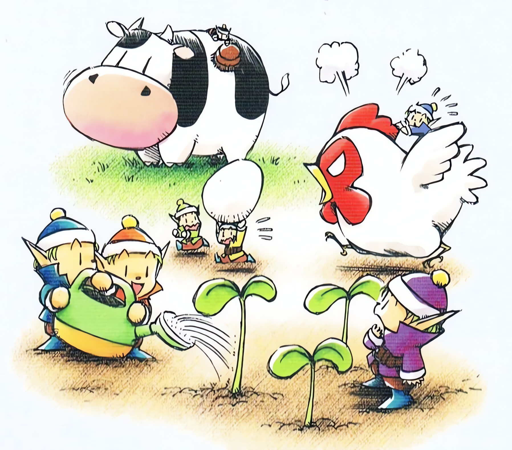

## Copy mode

`--copy` copies the files instead of linking them, so an install keeps working when the checkout moves or goes
away. The cost is that a copy does not follow the checkout: run `./install.sh --update --copy` after you pull.

| What | How it works |
|---|---|
| The marker | Each package directory (`super-ultra-code-plan/` and every `sucp-<name>/`) gets a `.vivera-managed` file. Its first line is `source=<checkout>`, and then one line `entry <name> <algo>:<digest>` per entry the installer placed. The digest is `sha256sum`, else `shasum -a 256`, else `cksum`; a directory's digest is built from a sorted listing of its directories (empty ones too), its symlinks (by target name, not followed) and its files (by content, plus the owner exec bit), with a plain file named `.DS_Store` left out. A digest that cannot be computed (no working hash tool, an unreadable entry, a FIFO) is empty and matches nothing, so such a copy counts as modified. The `ai-config` file gets a sidecar `Super Ultra Code Plan Implementation.md.vivera-managed`. |
| No links | Directories are copied with `cp -RL`, so no copy holds a link into the checkout, and the checkout's own internal link check is skipped. |
| Needs | `cmp` and `diff`. Without them `--copy` exits 1 naming the missing tool. `find` is needed too but is not checked for: without it every directory copy (`templates/`, `examples/`) is judged modified, so each `--update --copy` moves it to a backup. `--uninstall` without `--copy` still runs and judges each copy by its recorded digest alone: a copy that still matches its record is removed, any other copy is kept. |

Every managed copy is judged against the source and against its recorded digest:

| Judgment | It means | `--update --copy` | `--uninstall` and prune |
|---|---|---|---|
| identical | Same content as the source. | Nothing to do. | Removed. |
| pristine | Differs from the source, but still matches the digest recorded at install: it is outdated and you never edited it. | Refreshed, with no backup. | Removed. |
| modified | Matches neither, or has no record: you edited it. | Moved aside to a backup (`[BACKUP]`) first, then replaced. | Kept (`[KEEP]`). |

Other rules:

- **Git Bash, MSYS and Cygwin default to `--copy`.** There `ln -s` copies the file or fails unless symlinks are
  switched on, so a plain install would report links it did not make. The installer prints a `[NOTE]` and
  copies. This was seen only with a stub `uname`, not on Windows (not verified).
- **`.gitattributes` forces LF** for `*.sh` and `scripts/install/tiers.tsv`, because a Windows clone with
  `core.autocrlf` would turn every installer script into CRLF, and a carriage return after
  `set -euo pipefail` is not a valid bash command.
- **A copy install must be checked with `--check --copy`.** Without `--copy`, `--check` expects links, calls
  the copies `[stale]` and prints `[hint] those are copies made by --copy: run ./install.sh --check --copy`.
- `install.ps1` always copies and follows the same identical, pristine and modified rule, with its own digests
  (`ps-sha256` entries in the marker): a digest recorded by `install.sh` (`sha256:`) is never trusted, so such a copy
  counts as modified. One difference: behind a linked directory it leaves ANY link alone, including the installer's
  own, where `install.sh` in link mode still repoints its own links (`install.sh --copy`, the mode `install.ps1` corresponds to, leaves them alone too). It was run under PowerShell 7.6.6 on Linux only, not on Windows.

## Offline mode and the minimal tier

| Question | Answer |
|---|---|
| Does the installer use the network? | No. `install.sh` and the scripts it loads make no network call (`scripts/bootstrap.sh` is the one script that fetches): a search for `curl`, `wget` and URLs finds only the hint text that tells you how to install `bun`. An install with only the loopback interface up also passed. |
| Can I install from a tree with no `.git`? | Yes. A `git archive` tree installs with exit 0 (verified on Linux), including the sprite agents when `bun` is present. The git hook step is skipped, because the hook is only set in a checkout that has its own `.git`. |
| Can I install with no `git` and no `bun`? | Yes, at `--tier minimal`: skills only, no sprite agents, no git hook. `--check` and `--uninstall` need neither tool at any tier (verified on Linux with both absent from `PATH`: install exit 0, and `check: CURRENT` with the sprite-agents note appended when a sprite harness is selected). |
| What still needs the network? | Getting the files (a clone, a tarball, `scripts/bootstrap.sh`), installing `bun`, and `bun install` for the repository's own tests and validators. |

## Known limits

| Limit | Consequence | What to do |
|---|---|---|
| Installing from a second checkout takes over the first checkout's links. | The first checkout's links are judged `foreign` and moved to backups (13 `[BACKUP]` lines for a default install). From the first checkout, `--check` then reports `[foreign]` and `--uninstall` keeps the second checkout's links. `--uninstall` from the second restores the first's links, and they dangle if that checkout was deleted. | Use one checkout. To switch, run `./install.sh --uninstall` from the old one, then install from the new one. |
| A skills directory that is a symlink into another tree is left alone (`viadir`), and so is a sprite directory behind a symlink. | Behind a symlinked skills directory the installer never moves, removes or retargets anything that belongs to the other tree: an existing real file, a link that is not its own (a link of another checkout), and, in `--copy` mode, any link and any absent entry (a copy would be a real file in the other tree, which check, update and uninstall could then not manage). `--check` reports these as `[foreign]`, so it keeps exiting 1. In link mode it still creates its own links there (and the package directories that hold them); `--uninstall` removes the links and leaves those empty directories. A sprite directory behind a symlink is left alone too: `--check` prints `[skip]` and ends `check: CURRENT (sprite agents not verified: ...)` with exit 0. | Resolve it by hand (remove the symlink, or merge the trees), or leave that target out with `--skip`. Install from the checkout the symlink points to, never from a worktree or a second checkout, or its links are reported as someone else's. |
| `--check` is judged by the flags you give it. | Nothing records the tier or the target list you installed with. After `--tier minimal` or `--only a,b`, a plain `--check` (tier `standard`, every detected target) reports the sprite agents or targets you left out as `[missing]` problems and exits 1. | Run `--check` with the same `--tier`, `--only` and `--skip` you installed with. |
| A backup moves the colliding entry itself: a file such as `SKILL.md`, or a whole directory of yours that sits at the path of `templates/` or `examples/`. | The package directory and your other files beside the installer's links stay where they are. Uninstall puts each moved entry back. | Copy the directory yourself first if you want a full snapshot. |
| Copy mode with Claude Code keeps the agents' hook path pointing into the checkout. | The sprite files carry `bun "<checkout>"/.claude/hooks/block-git-writes.mjs`. If you delete the checkout, the git guard hook is gone and the guard stops working. | Keep the checkout while the sprites are installed, or re-render after moving it. |
| `--uninstall` removes a sprite directory only when it ends up empty. | That can remove an empty `~/.cursor/agents` or `~/.codex/agents` that you created yourself. No file is lost. | Recreate it with `mkdir` if you want it back. |
| A file named `.DS_Store` inside a copied directory is treated as Finder litter. | It is left out of the digest and of the comparison, so adding content to a file with that name does not count as an edit. `--uninstall` deletes it with its directory, without a backup; `--update --copy` deletes it without a backup only when it refreshes that directory (an otherwise identical copy is left as it is, `.DS_Store` included). | Do not keep your own content in a file with that name. |
| The marker is a trust boundary. | Anyone who can edit `.vivera-managed` can make the installer treat an edited file as untouched, and `--update` then replaces it with no backup. | Keep your harness directories writable only by you. The marker is bookkeeping, not a security control. |
| An interrupted run leaves a temporary copy. | A copy is made under `<dest>.vivera-tmp-<pid>` and renamed into place only when it is complete, so a killed run never leaves a partial copy at the destination. The next run that copies that destination, and every `--uninstall`, removes a leftover temporary name of exactly that shape. | Nothing, unless you keep your own file named `<dest>.vivera-tmp-<digits>` beside an installer destination: `--uninstall` removes it, and so does an install or update that copies that destination again. |
| A change that keeps the bytes (a `chmod`, a new modification time). | It is not an edit: `cmp` and `diff` call the copy identical, so `--update` without `--copy`, a link-mode install and `--uninstall` replace or remove it and the change is lost; `--update --copy` finds the copy already current and leaves it as it is. The bytes still exist in the checkout. | Keep permission changes in the checkout, not in an installed copy. |
| A generated sprite file you edited by hand (its `# Generated by` marker line is still there). | The installer treats it as its own: `--check` reports `[stale]`, and the next install or `--update` rewrites it with no backup. | Edit `agents/roles/<role>.md` or `agents/crew.json` instead, or delete the marker line to make the file yours (then the generator refuses to touch it and the run exits 1). |
| A clone or copy of an installed skill directory carries the marker. | An unedited clone at a path the installer manages (for example another harness's skills directory) is treated as the installer's own: `--update` refreshes it when its source changed and `--uninstall` removes it, with no backup. A clone under a new `sucp-<name>` is pruned by `--update` when unedited (kept with `[KEEP]` when edited or when its `SKILL.md` is a symlink) and `--uninstall` never touches it. | Delete the `.vivera-managed` file in the clone. |
| Without `sha256sum` and `shasum`, a 32-bit `cksum` is used. | The digest is weaker, so a changed copy is more likely to be judged untouched. With no working hash tool at all every digest is empty: the marker holds only `source=`, and every outdated copy counts as modified and is backed up on `--update --copy`, never deleted. | Install `sha256sum` or `shasum` (coreutils). |
| A hand-written file that has a sprite's name. | The generator refuses to overwrite it and leaves it untouched, still writes the other six sprites of that harness, the other targets still finish, and the run exits 1. | Rename or move your file. |
| A read-only `HOME`. | The run exits 1 and writes nothing. | Make `HOME` writable. |
| macOS, WSL, Windows native and Docker are not verified. | Everything on those platforms is untested, not known to fail. `install.ps1` was run only under PowerShell 7.6.6 on Linux, and the Dockerfile was never built. | Start with `--dry-run`, then `--check`. |
| bash 3.2 and BusyBox were never run. | The code avoids bash 4 features, by reading and by a grep for them, not by a run. `shellcheck -S warning` was also run by hand (it is not part of `bun run ci`), but it does not check the bash version. | Report a failure with the output of `--dry-run`. |

<h3 align="center" id="the-harvest-sprites">The Harvest Sprites</h3>

  
   
  <em>The seven Harvest Sprites at work. Official Back to Nature artwork © its owners.</em>

This section follows the PlayStation game *Harvest Moon: Back to Nature* (Victor Interactive Software,
Japan 16 December 1999, English release by Natsume on 22 November 2000), not *Friends of Mineral Town*,
whose sprites work differently (see the [glossary](../../docs/vivera-glossary.md)). In it the seven Harvest
Sprites (コロボックル, *Korobokkuru*) live in a small hut behind the Church. Talk to one twice to ask for
help once it has at least 2 hearts of affection, then hire it for 1 day, 3 days, or a week, starting
the next day, to water crops, harvest crops, or take care of animals. In Spring they only talk about their Tea Party, and you must talk to the same sprite five times
to get any work out of it. They look identical except for the color of their hat and shirt, and the
seven colors together span the rainbow. In Vivera each sprite is a named subagent: the name and the
color stay, but a sprite gets a fixed role in `agents/crew.json` instead of a free choice of job.

| Sprite | In the game (PlayStation) | Role in Vivera | Default affinity | What it does |
|---|---|---|---|---|
|  **Chef** | Red. Birthday Fall 14. Loves to cook. In the fourth year he is found afraid of the dark, carrying a lantern. | `implementer` | harvesting | Implements one chunk of an approved plan, test first, inside the permitted files. |
|  **Nappy** | Orange. Birthday Winter 22. The brothers live together in his house. | `implementer` | animal care | Same role as Chef, on a different chunk. |
|  **Hoggy** | Yellow. Birthday Fall 10. Loves to sleep and is lazy about work. | `implementer` | harvesting | Same role as Chef, on a different chunk. |
|  **Timid** | Green. Birthday Summer 16. Easily scared. | `researcher` | animal care | Investigates one narrow question about the code, the history, or the web, and edits no files. |
|  **Aqua** | Light blue. Birthday Spring 26. Likes to dress nicely. | `researcher` | watering | Same role as Timid, on a different question. |
|  **Staid** | Dark blue (sources also say blue or indigo). Birthday Spring 15. | `reviewer` | animal care | Audits a diff, a subagent report, or a completion claim against fresh evidence, and edits no files. |
|  **Bold** | Purple. Birthday Spring 4. Brave, and scares others off with a battle cry. | `debugger` | watering | Isolates the root cause of one failing test or reproducible bug by hypothesis and probe, then fixes it at the shared cause. |

Four things are worth knowing:

- **The game tracks two numbers per sprite.** Affection rises one heart per 25 points and drops by 2
  for every day the sprite works for you. A hidden skill level per job starts at 0, rises by 1 each
  time it does that job, and tops out at 255.
- **Need matters, weather does not.** You cannot hire a sprite for a job that has nothing to do that
  day, but a hired sprite still comes in a hurricane or blizzard, which makes it useful for feeding
  animals during storms.
- **Jobs are a default, not a rule.** In the game any sprite can do any of the three jobs, one per
  request. In Vivera the role is fixed by the roster, while the affinity column is only the default
  for fan-out (watering is keep-alive work, animal care is long-lived assets, harvesting is
  shipping). The parent may send any sprite to any chunk. See
  [The Vivera Glossary](../../docs/vivera-glossary.md).
- **Agent colors differ for two sprites.** `agents/crew.json` gives Aqua `blue` and Staid `cyan`, while
  the game has Aqua light blue and Staid dark blue.

*The sprite portraits in the table are Harvest Moon artwork from the Harvest Moon Wiki, © their respective owners. Game facts and their sources are listed in [the glossary](../../docs/vivera-glossary.md). Vivera is an independent project and is not affiliated with the Harvest Moon franchise.*
