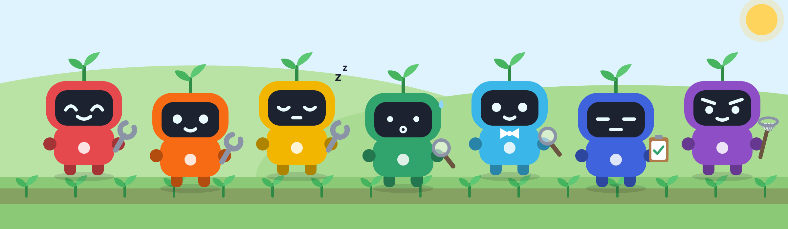
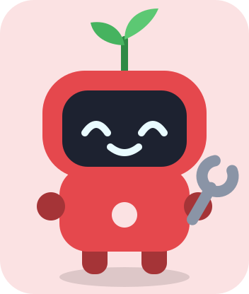
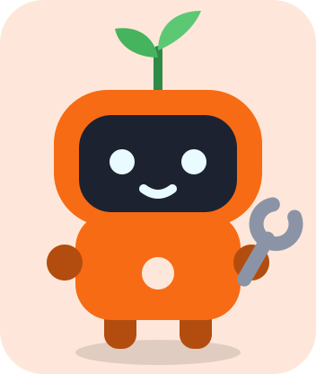
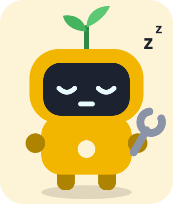

# The Harvest Sprites

  
   
  <em>The seven Harvest Sprites at work, drawn for Vivera.</em>

This page follows the PlayStation game *Harvest Moon: Back to Nature* (Victor Interactive Software,
Japan 16 December 1999, English release by Natsume on 22 November 2000), not *Friends of Mineral Town*,
whose sprites work differently (see the [glossary](../../docs/vivera-glossary.md)). In it the seven Harvest
Sprites (コロボックル, *Korobokkuru*) live in a small hut behind the Church. Talk to one twice to ask for
help once it has at least 2 hearts of affection, then hire it for 1 day, 3 days, or a week, starting
the next day, to water crops, harvest crops, or take care of animals. In Spring they only talk about their Tea Party, and you must talk to the same sprite five times
to get any work out of it. They look identical except for the color of their hat and shirt, and the
seven colors together span the rainbow. In Vivera each sprite is a named subagent: the name and the
color stay, but a sprite gets a fixed role in `agents/crew.json` instead of a free choice of job.

| Sprite | In the game (PlayStation) | Role in Vivera | Default affinity | What it does |
|---|---|---|---|---|
|  **Chef** | Red. Birthday Fall 14. Loves to cook. In the fourth year he is found afraid of the dark, carrying a lantern. | `implementer` | harvesting | Implements one chunk of an approved plan, test first, inside the permitted files. |
|  **Nappy** | Orange. Birthday Winter 22. The brothers live together in his house. | `implementer` | animal care | Same role as Chef, on a different chunk. |
|  **Hoggy** | Yellow. Birthday Fall 10. Loves to sleep and is lazy about work. | `implementer` | harvesting | Same role as Chef, on a different chunk. |
|  **Timid** | Green. Birthday Summer 16. Easily scared. | `researcher` | animal care | Investigates one narrow question about the code, the history, or the web, and edits no files. |
|  **Aqua** | Light blue. Birthday Spring 26. Likes to dress nicely. | `researcher` | watering | Same role as Timid, on a different question. |
|  **Staid** | Dark blue (sources also say blue or indigo). Birthday Spring 15. | `reviewer` | animal care | Audits a diff, a subagent report, or a completion claim against fresh evidence, and edits no files. |
|  **Bold** | Purple. Birthday Spring 4. Brave, and scares others off with a battle cry. | `debugger` | watering | Isolates the root cause of one failing test or reproducible bug by hypothesis and probe, then fixes it at the shared cause. |

Four things are worth knowing:

- **The game tracks two numbers per sprite.** Affection rises one heart per 25 points and drops by 2
  for every day the sprite works for you (Prima's official guide says 1; the glossary lists both). A hidden skill level per job starts at 0, rises by 1 each
  time it does that job, and tops out at 255.
- **Need matters, weather does not.** You cannot hire a sprite for a job that has nothing to do that
  day, but a hired sprite still comes in a hurricane or blizzard, which makes it useful for feeding
  animals during storms.
- **Jobs are a default, not a rule.** In the game any sprite can do any of the three jobs, one per
  request. In Vivera the role is fixed by the roster, while the affinity column is only the default
  for fan-out (watering is keep-alive work, animal care is long-lived assets, harvesting is
  shipping). The parent may send any sprite to any chunk. See
  [The Vivera Glossary](../../docs/vivera-glossary.md).
- **Agent colors differ for two sprites.** `agents/crew.json` gives Aqua `blue` and Staid `cyan`, while
  the game has Aqua light blue and Staid dark blue.

*The sprite portraits on this page are original artwork drawn for Vivera (SVG sources next to the PNGs in `docs/images/`), not art from the game. Game facts and their sources are listed in [the glossary](../../docs/vivera-glossary.md). Vivera is an independent project and is not affiliated with the Harvest Moon franchise.*
