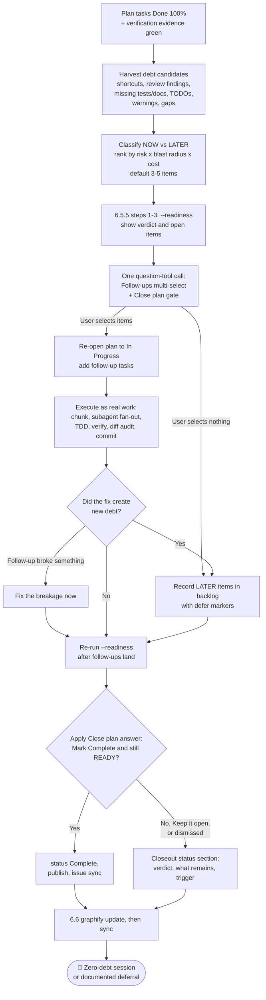

### ⭐ Progress stars
The meter line during the sweep (`sucp-rules`, Output) is one star per debt the sweep found, so 7 debts are 7 stars and 5 debts are 5. The total follows the findings and is never fixed or padded. The stars appear in the chat reply only; the sweep record holds the evidence, never the stars.

- **What counts as a debt:** every candidate in the ranked list from 6.2, `NOW` or `LATER`. Learning-harvest rules (6.2.8) are not debts and get no star.
- **`★` closed, `☆` open, closed ones drawn first.** A debt is closed when its follow-up was executed and verified with fresh evidence. A debt the user declined, or one recorded as `LATER` with a `defer:` line, stays `☆`, and the line says how many are deferred, for example `★★★☆☆ · 3 closed · 2 deferred`.
- **No stars before the ranked list exists.** Once it does, every star starts as `☆`. A sweep that finds no debt prints `0 debt found` instead of stars.
- **The total can grow.** A candidate found by the re-pass after a follow-up batch (6.5) adds a star and the line says `+1 debt`. It stays `☆`, because it goes to the backlog (6.5). Existing stars keep their state.

### 🚫 Anti-Patterns
- Closing the session with a report and no question. A debt sweep that produces prose instead of a selectable question has not run.
- Letting generated Markdown stay invisible to `graphify query` because `graphify update` "should have handled it". It only parses code; run `bun "$VIVERA/scripts/graphify-sync.mjs" --root "$(pwd)"` from the session repository after it, every session (6.6).
- Generic chips (`"Anything else?"`, `"More tests?"`) with no file path and no finish line. Unactionable options waste the user's attention and get ignored.
- Padding to 3-5 items with speculative work, or asking 8 questions because everything looked interesting. Rank first, then cap.
- Turning a follow-up question into a new scope decision. The user picking an item is approval to close known debt inside the same goal, not approval to redesign the feature.
- Re-asking the declined items, or treating "no" as a reason to reopen the verified plan.
- Running a second follow-up round from the re-pass. New debt goes to the backlog; only breakage the follow-up caused is fixed now.
- Doing the follow-ups silently without asking, which violates the check-first contract, or asking and then not doing them, which is worse.
- Closing the session without the plan closeout decision. A plan whose work merged but whose status nobody decided stays `Approved` and its issue stays open; run `--readiness` and ask the `Close plan` gate every time.

