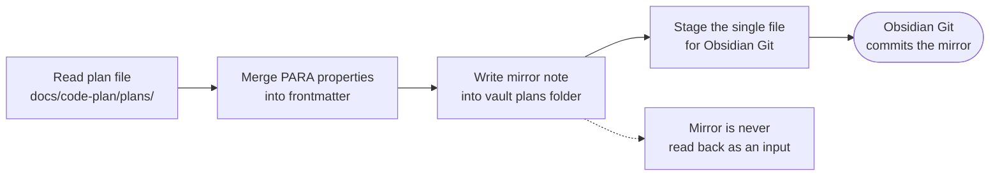
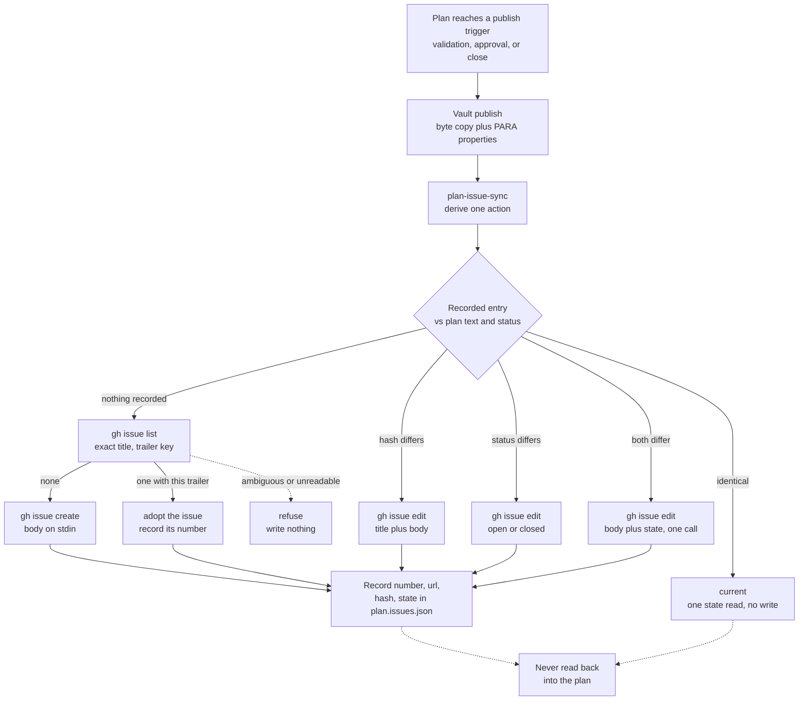

### 📤 Plan Publishing

- **Step 3 is not optional bookkeeping.** Without it the mirror keeps the step-2 snapshot forever, so a plan whose work is finished reads `status: Draft` in the vault. That is a known and measurable state: `bun scripts/plan-lifecycle-audit.mjs` counts exactly how many plans are in it and why, not something to be guessed at.
- **The runner never writes to a plan file.** `ultra-plan-runner.mjs` reads the plan, prints a ledger, and exits; it has no write path at all. So ticking is a separate, explicit step, and that separation is deliberate: a checkbox that the runner could set itself would be a claim rather than a record.

- **The runner reports it on every execution.** `bun scripts/ultra-plan-runner.mjs <plan.md> --execute` checks the plan's mirror first; when it is missing or stale it prints `MIRROR WARNING` with the mirror path, the reason, and the fix (`bun scripts/plan-sync.mjs <plan.md>`), then executes. The mirror is derived state, so a stale copy is reported loudly but never blocks the work. A dry run never checks it, so validating a plan still works on a machine with no vault.
- **A review verdict belongs in the source plan, never in the mirror.** Publishing twice means the second publish overwrites the first, so a verdict written into the vault note is erased by the next publish without warning. Write it into the plan's approval section, which is the direction that survives.
- **The mirror is a byte copy, so the plan is authored once, in the repository's language, and never translated on the way into the vault.** The publisher copies the plan text unchanged and injects only the vault properties, and `source_hash` is computed over that whole text. A translated mirror therefore reads as stale on the next `--check`, warns on every `--execute`, and fails the daily drift timer. The user's prompt language belongs in the conversation and in the reasoning; the plan, the mirror, and every review verdict belong in the plan's own language. When someone wants to deliberate in a different language, that is a separate scratch note in the vault that links back to the plan, never a translation of the plan.
- **Concretely, a deliberation note lives at `01 - Projects/{project}/notes/<plan-id>.notes.md` and is never published.** The publisher writes only into the `plans/` folder named by `destDirTemplate`, so a note in the sibling `notes/` folder can never be clobbered by a publish and can never register as drift. Such a note is vault-native rather than a repository artifact, so the codebase-language rule above does not bind it: a Chinese deliberation note is legitimate content, not a rule violation. The one thing that must cross back into the repository is the resulting decision, written in the plan's own language.
- `SKIPPED-IDEMPOTENT` is a pass, not a failure: publishing an unchanged plan twice prints `SKIPPED-IDEMPOTENT`, writes nothing, and stages nothing. Nothing happened because nothing needed to happen. Do not go investigate a non-problem.
- One-way: the project repository is the source of truth; the vault copy is a read-only mirror. Never edit a mirrored note in the vault: edit the plan in the project and re-run the publisher. Two-way sync is permanently rejected, not deferred, because a vault edit is invisible to the repository and the mirror can no longer be regenerated from the truth.
- The check: `bun scripts/plan-publish.mjs --check --all` exits 1 when any mirror is missing or stale, and is the gate to run when verifying that a plan is published. `--status` is a human report: it prints a table and always exits 0, so it is never a gate.
- **Exit codes, so a caller can tell the three failures apart without parsing text:** the publisher exits `0` on success or idempotent skip, `1` on drift or a missing mirror, `2` on a usage error. The plan runner exits `1` on validation or task failure and `2` on a usage error; a missing or stale mirror is a warning, not an exit code, and its fix is to publish (`plan-sync.mjs`), never to edit the plan. A daily `systemd --user` timer runs the drift check unattended and surfaces a failure in `systemctl --user --failed`; it is the safety net for a plan published outside this pipeline, not a substitute for the publish step.
- Not hardwired: the CLI reads `PLAN_PUBLISH_CONFIG` to locate `plans.publish.json` instead of the repository copy, so a later session can point the publisher at another registry without editing the script.
- Failure handling: a non-zero exit does not invalidate the plan. The plan is still valid and still saved in the project; the mirror is derived state. Report the failure and its exit code. Do not hand-copy the file into the vault as a workaround: a hand copy carries no `source_hash`, so it reads as permanent drift to `--check` and can only be fixed by deleting it and republishing by hand.

```
bun scripts/plan-sync.mjs docs/code-plan/plans/YYYY-MM-DD-<feature>.md [--project <key>]
bun scripts/plan-publish.mjs docs/code-plan/plans/YYYY-MM-DD-<feature>.md
bun scripts/plan-publish.mjs --check --all
bun scripts/plan-publish.mjs --status
bun scripts/plan-mark-done.mjs docs/code-plan/plans/YYYY-MM-DD-<feature>.md --from runner.log
bun scripts/plan-lifecycle-audit.mjs
```



## 🐙 Plan → GitHub Issue
> The second derived copy. The Obsidian mirror makes a plan searchable and readable; the issue makes its **history** searchable: who opened it, when it was approved, what was closed and when, and every comment in one timeline that GitHub already indexes, notifies, and links from the commit.

### Same rule as the vault mirror: one way, forever
The project repository is the source of truth. The issue body **is** the plan text, byte for byte, plus a machine-readable trailer. Nothing is ever read back from GitHub into the plan.

- **A summary body is banned.** A summary is a second source of truth that drifts the moment the plan changes, and then the issue is quietly wrong. The body is the plan, and its `source_hash` is what makes "is this issue current?" answerable from the issue alone. A plan too long for GitHub's 65,536-character body limit becomes its longest verbatim prefix, cut at a line boundary, followed by one explicit `**Truncated:**` line naming N of M characters and the plan's repository path, then the unchanged trailer; the hash still covers the full plan, and truncation is never a reason to summarize.
- **An issue comment is a discussion about the plan, never an edit to it.** A decision reached in a comment crosses back into the repository as an edit to the plan file. The comment is where the deliberation happens; the plan is where the decision lives.
- **The issue number lives in `plan.issues.json`, never in the plan's frontmatter.** This is load-bearing. The vault mirror hashes the entire plan text, so writing an issue number into the plan would change `source_hash` and instantly make every vault mirror stale. A sidecar keeps the plan byte-stable.
- **A hand-closed issue is not authoritative.** The issue is derived state, so the plan wins: an in-progress plan whose issue was closed by hand reopens it on the next sync. Closing the issue to tidy a board must not permanently detach a plan from its mirror.

```bash
bun scripts/plan-issue-sync.mjs docs/code-plan/plans/YYYY-MM-DD-<feature>.md
bun scripts/plan-issue-sync.mjs --check <plan.md>...   # drift report, never writes
bun scripts/plan-issue-sync.mjs --status                # table, always exit 0
```

### The state mapping is derived from the plan, never chosen
| Plan `status` | Issue state |
|---|---|
| `Draft`, `Approved`, `InProgress`, `Verification` | open |
| `Blocked` | open. Blocked means unfinished, so closing it would report done. |
| `Complete` | closed |

- The sync is a pure decision over `(recorded entry, live issue state, plan text, plan status)`, resolving to exactly one of `create`, `update-body`, `update-state`, `update-and-state`, or `current`. That is what makes running it twice safe, and it is why the whole matrix is unit-tested without a network.
- **`current` is the real no-op**: it writes nothing and costs one read, `gh issue view --json state`, because the recorded state is the script's own past opinion and is checked against GitHub rather than believed. A duplicate issue in a real repository is the failure this prevents, and a body edit never silently closes or reopens the issue.
- **An unrecorded plan looks before it creates.** With no issue number recorded, the sync lists the repository's issues (`gh issue list --state all`, without `--search`, so the read has no search-index lag) and matches the title exactly. One match whose `plan-sync` trailer names this plan's key is adopted: its number is recorded and the normal update path runs. The run reports `adopt` when the issue needs no edit, and otherwise the edit it made (`update-body`, `update-state`, or both) with `adopted: true` in the result; `--check` reports the pending action and exits 1, because the sidecar is missing the row. A same-title issue without that trailer, two or more matches, a failed list, or a list cut at its limit is refused with the issue numbers named, and nothing is created or written. This covers a create that reached GitHub while its local record was lost.
- **The body goes on stdin** via `--body-file -`, never on argv. On argv a 10 KB plan hits `ARG_MAX` and goes through the shell's quoting rules, so the bytes stop being identical to the plan, which is the entire premise.
- **A project with no configured repository is refused, not guessed.** `plan.issues.json` maps project name to `owner/repo` explicitly. A plan filed under the wrong repository is worse than one that is not filed. Without `--project`, the key is the directory name (or `<root>` for a `<root>-wt/<slot>` worktree), and the checkout's `origin` remote counts too when its `owner/repo` is already a configured value; a key and an origin that name different configured repositories are refused, naming both.
- **A plan with no `status:` in its frontmatter is refused**, because there is no state to derive.
- **A failure here does not invalidate the plan.** The plan is valid and saved in the project; the issue is derived state, exactly like the vault mirror. Report the failure and its exit code, and do not hand-create the issue as a workaround, because a hand-created issue carries no trailer and so reads as permanent drift.
- `gh` must be authenticated before the first sync, not discovered at issue-creation time. `gh auth status` once, at the start of the session.


