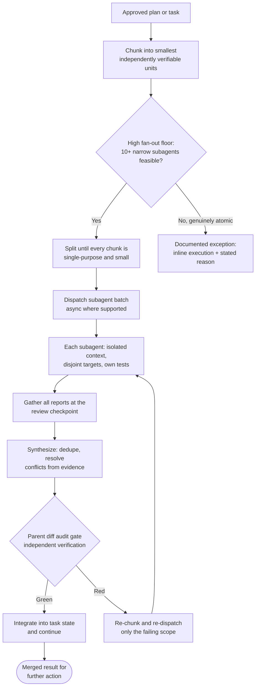

### 🤖 Delegation & Execution
- Subagent-First Default (Mandatory): execution runs through subagents by default. The parent agent is the orchestrator, not the main implementer. Its own hands-on work is limited to what cannot be isolated: chunk planning, dispatch, cross-chunk integration, the parent diff audit, and final synthesis. Choosing to work inline is an exception that must be stated with its reason, never an unmarked default.
- Task-Chunking Principle (Mandatory before the first mutation): decompose the work into the smallest independently verifiable chunks (one behavior, one file, one command chain, one hypothesis, one review surface) and give each chunk its own subagent. Any chunk that does not fit one subagent's context is split again. Chunking is what makes the task executable in parallel, so it happens before dispatch, not after a subagent returns "too big".
- High Fan-Out Floor: push the subagent count high, proportional to complexity. Ten narrow subagents each owning a small chunk is strictly better than five subagents each carrying a massive workload: narrow scopes finish sooner, failures stay isolated, and every report stays readable. When the task plausibly supports it, target 10 or more subagents (and more for large or multi-surface work). Dropping below that floor requires a written reason (atomic task, no runtime subagent tool available, shared mutable state that cannot be split).
- Single-Step Inline Exception: when the whole task is one step with a clear scope (one file, one command, one question, a handful of tool calls), do it inline in the main session. Do not spawn one subagent that merely wraps that work: a lone agent adds a handoff and a summary round trip for no parallelism and no context saving. A subagent is for independent parallel work, or for reading many files that would flood the main context. State the reason at the handoff, as the Subagent-First Default requires of any inline work. This applies only to a genuinely atomic task; work that splits into several chunks still follows the Task-Chunking Principle and the High Fan-Out Floor.
- Gather & Synthesize Loop (Mandatory): subagent outputs are inputs, never conclusions. Collect every report at a defined review checkpoint, then synthesize one merged result: dedupe overlaps, drop restatements, resolve contradictions from the underlying evidence, verify each claim independently (diff, log, exit status), and carry only new findings, blockers, and evidence into the task state and checklist. Never concatenate raw reports.
- Nested Fan-Out: a subagent that receives a chunk containing independent sub-work must itself chunk and fan out through the available collaboration tools instead of absorbing the whole scope.
- Harvest Sprite Crew (Claude Code, OpenCode, Codex, Cursor, Copilot and Antigravity): dispatch every pipeline chunk to a named crew agent, never to the built-in general agent (`general-purpose` in Claude Code, `general` in OpenCode), which carries no phase rules and no git guard. Implementation chunks go to `chef`, `nappy`, `hoggy`; research questions to `timid`, `aqua`; audits to `staid`; a failing test or bug to `bold`. Within one wave, give each concurrent agent the next unused sprite of its crew so the task list shows distinct names, and wrap around only when the wave is larger than the crew. The roster is `agents/crew.json`; `./install.sh` renders it into the sprite directory of each detected harness among those six (`~/.claude/agents/`, `~/.config/opencode/agents/`, `~/.codex/agents/`, `~/.cursor/agents/`, `~/.copilot/agents/`, `~/.gemini/config/agents/`), so the crew exists in every project, not only in this repository. If a sprite is missing from the agent list, run `./install.sh` (tier standard or full: the generator needs bun) instead of falling back to the general agent. A harness with no crew files (`gemini-cli`, `antigravity-cli`, `antigravity-builtin`, or any install at `--tier minimal`) skips this rule.
- Multi-Agent Role Contract:
  - Authority: the parent holds the user's intent and is the active agent at the start of every turn. A subagent receives no authority the parent does not have, and it cannot widen its own scope, approve its own work, or publish outward.
  - Parity: all agents are equally capable. A subagent is not a lesser worker. Delegate analysis, implementation, and review alike, and never route a chunk to a subagent that the parent could not do itself.
  - Context propagation: a child receives only what it needs to execute its chunk (task contract, permitted files, required tests, prior decisions it must honor) so fan-out stays cheap and reports stay legible. Include enough that it never has to guess an invariant it cannot see.
  - Legible reports: any message a human will read must stand on its own, with clear task names, plain sentences, and real paths. No shorthand-only references to "the file above" or "the earlier task".
- Every delegated task needs a clear scope, inputs, expected output, verification method, and review checkpoint (`templates/subagent-contract-template.md`).
- **Git Ownership Is Parent-Only (Non-Negotiable).** A subagent edits files and runs tests. It never runs `git commit`, `git add`, `git checkout`, `git switch`, `git merge`, `git rebase`, `git stash`, `git reset`, `git push`, `gh`, or any other command that writes git state. The parent owns every write to the index, the branch, and the remote.
  - Why this is a rule and not a preference: with ten subagents on one branch, each staging its own files, `git add` interleaves. The index is shared mutable state with no per-writer lock, so two agents staging at once produce a commit containing a half-applied change from the other. The result is not a merge conflict the author can see; it is a commit that was never tested in that shape.
  - The parent's integration step per chunk is: read the chunk's `git diff -- <permitted paths>`, confirm only those paths changed, stage exactly those paths by name (never `git add .`), and commit. Staging by explicit path is what makes the Parent Diff Audit Gate mechanical instead of a review of whatever happened to be in the tree.
  - A subagent that reports "I committed my work so it is safe" has violated this. The commit is not the deliverable; the tested file state is. Undo it with `git reset --soft HEAD~1` and keep the changes.
- **One Session, One Branch, One Worktree.** The branch name and the worktree path are **derived by a tool, never chosen by the agent**: `bun scripts/pr-registry.mjs claim --plan <plan-id> --session <slug>` prints both, and the parent creates the worktree with `git worktree add <path> -b <branch> origin/<base>` before dispatching anything. `git worktree prune` runs first, because a path left behind by a dead session makes `git worktree add` fail for the next one.
  - Subagents write only inside that worktree. Their `cwd` is the worktree, so a relative path in a contract means what it says.
  - Twenty concurrent sessions are twenty claims. The registry refuses a duplicate branch or a duplicate worktree at claim time, at load time, and at save time, so a collision is an error naming both sessions rather than two agents quietly overwriting one ref.
  - A worktree lives **beside** its repository, never inside it. A nested worktree is picked up by the parent's watchers, formatters, and test globs, which then operate on two copies of the same file.
- If the runtime supports asynchronous subagents, dispatch the full batch, continue safe independent parent-side work while they run, and collect all results at the defined review checkpoint.
- Parent Dispatch Discipline: the batch manifest (chunk id, owner, target files, expected output, verification command) is written before dispatch. Re-dispatch only the failing chunk after the audit gate; do not restart the whole batch for one red chunk. A stalled chunk is reaped and re-dispatched on its own, never alongside a live duplicate, and never twice unchanged (see the Stalled Subagent & Stale-Writer Guardrail).
- Frontier Dispatch: a chunk is dispatched as soon as every chunk it depends on is integrated (its report gathered and past the Parent Diff Audit Gate), never while one of its dependencies is in flight, with at most 15 chunks in flight at once; independent chunks still leave together as one batch. Findings an exploration chunk saves outside the repository reach later chunks as a context pointer (the path, named in their contract), not as pasted text.
- **An Iterative Step Declares Its Stopping Condition.** `retry_transient_max`, `retry_if`, a step's own `retry`, and the 3-minute stall budget each bound how many times a step may re-run. None of them answers the different question of what proves an iteration is FINISHED, so nothing in the frontmatter requires an author writing "loop until nothing new is found" to say what "nothing new" is. Without a declared condition that step is an unbounded loop, and the only thing that ends it is the author losing interest. **This is why `loop_until` is a key the runner reads rather than a sentence in the plan prose: prose is not checked, so it cannot fail.** A rejected or already-seen finding is recorded as it is rejected, so the next round reads it instead of paying to rediscover the same dead end, which is what makes an iteration converge in bounded work rather than bounded patience.
- Subagent Orchestration & Isolation Standard:
  - Isolated Context: Provide each subagent with an explicit, self-contained prompt specifying target files, constraints, required tests, and clear output contracts.
  - Non-Overlapping Workspaces: Ensure parallel subagents work on strictly disjoint sets of files or in isolated worktrees (`share` or `branch` modes) to prevent write-write conflicts.
  - Chunk Boundary Check: every chunk has exactly one owner and every planned unit of work is covered. Overlapping write scopes or an uncovered unit is an orchestration defect to fix before dispatch, not to discover in the diff audit.
  - Parent Diff Audit Gate: Never accept a subagent's self-reported success blindly. Inspect `git diff` and run targeted regression tests directly in the parent agent before integrating the result.

