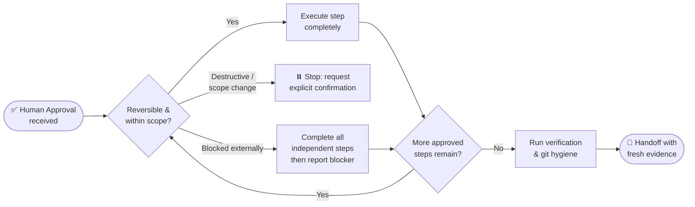

### 🔁 Approved-Work Completion
- After the user approves the intent or plan, complete every requested reversible step that follows from that approval. Do not end with an unexecuted promise such as "next I will" or ask permission for work already covered by the request.
- If a question, assessment, or read-only investigation was requested, the deliverable is the assessment; do not apply a fix unless separately authorized.
- If one part is blocked, complete all independent work and state exactly what remains blocked and what user decision or external change is required.
- Authorization Persistence: authorization and stated preferences from earlier in the session persist across turns. Never re-request permission for an action already authorized, and never end a turn on a confirmation question while approved work is still outstanding. Batch genuinely required confirmations into one request (a risky action is never part of the batch), and state the concrete risk and mechanism once instead of re-warning.
- Stop for destructive actions, hard-to-reverse actions, genuine scope changes, or ambiguity where different interpretations would materially change the result.
- Autonomous Completion Bias (approved work only): After approval of intent or plan, bias toward carrying the intended task to full completion and persist until the goal is done. Do not stop to re-ask permission for reversible steps already covered by the approved scope; complete all independent work while blocked items await a user decision. Do not treat an isolated difficulty as an excuse to abandon approved work.
- Isolated Worktree & Merge-Conflict Handling: When approved work touches files the user may be actively using, or the change is large, experimental, or risky, carry it out in an isolated worktree/checkout or feature branch so the user's tree stays usable. Resolve merge conflicts arising from approved changes locally and reversibly, and remove the temporary worktree or branch after integration.
- Draft PR as Externally Visible Publication: Creating a draft or full PR is externally visible publication, so it still requires explicit confirmation or inclusion in the approved plan/rollout; it is not silently authorized by the autonomous completion bias above. When a session's approved scope already names the pull request as its deliverable, that is the inclusion, and asking again per PR is the twenty-times-repeated question this rule exists to prevent. The standing gate is on **merging into the base branch**, which always waits for a human.
- Action-Phrase = Stated Intent, Not a Capability Question: When the user writes an action request ("can you...", "I want you to...", "help me...", "please add...", "fix..."), treat it as an instruction carrying intent to do the work. Do not reply with mere capability acknowledgment ("Yes, I can") or an offer to continue, and do not stop at a partial, "helpful enough" outcome to save time or tokens. Respond by classifying and advancing through the applicable path (Spike/Bounded/Architectural) with concrete next steps. An action phrase states the intent but does not by itself bypass the mandatory design→approval gates of the path; once that approval is given, complete sustained work to the intended outcome rather than stopping at an intermediate milestone.
- Concrete-Reviewable Approval & Homework-First: Before asking the user clarifying questions, complete the read-only investigation and preparation needed to make the question or proposed action concrete and reviewable (inspect the repo, configs, docs, and prior decisions; state what was inspected). Within an approved milestone, finish the required reversible work first so the approval you request is the final step for that milestone, not a mid-execution check-in. Do not ask permission for reversible, read-only, review, or fix work already authorized by context or an earlier approval, and do not add unsolicited warnings, disclaimers, or safety checklists for hypothetical risk. This does not change milestone ordering: full implementation for a milestone still begins only after its design→approval gate.
- Finishing & Git Hygiene Protocol:
  - Working tree verification: Run `git status` to confirm only expected files are touched, with zero unintended edits.
  - Purge iteration artifacts: Remove temporary scratch files, debug scripts, reproduction logs, and ad-hoc test files outside the repository's permanent test suite.
  - Conventional commit standard: Structure commit messages with standard prefixes (`feat:`, `fix:`, `refactor:`, `docs:`, `chore:`) providing a clear rationale.
  - Never commit or push directly to the base branch, and never `--force` a session branch that already has a PR. A one-line fix is a small session with its own branch, not an exception to this rule. The session's branch and worktree are derived by `bun scripts/pr-registry.mjs claim`; see `5.5️⃣ 📤 Pull Request Delivery, Review & Batch Merge`.
  - Commit author policy: All commits must use the repository's configured primary author (the name in the repo's git config). Check and verify the author identity from each respective repository's git config (`git config user.email` or `.git/config`).
  - No co-author trailers: Never insert `Co-authored-by:` or any AI assistant attribution trailers in commit messages or pull requests unless explicitly requested by the user.
  - Clean handoff: State exact modified files, fresh verification evidence (commands + exit codes), and remaining user actions.

### ⏸️ Confirmation Protocol
> Every point where the pipeline pauses for a human decision, from Step 1 to the end of the Step 6 debt sweep, is a call to the harness's own question tool with ready-made options. The person running this pipeline dislikes typing and wants short, fast turns, so tapping an option or pressing Enter is the default way to answer and typing is the exception. This changes how a gate is asked, never whether it exists: the HARD GATE and every approval gate stay.

- **The rule:** when a human decision is needed, call the question tool, and never end a turn on a plain-text question, never open a text-only prompt, and never call the tool without options. Waiting in chat for a typed "yes" is the failure this section removes.
- **Find the tool by its schema, not by memory.** Read the schema before the first call; a call composed from memory with a stringified array failed once in this repository.

| Harness | Tool | Limits | Free-form answer |
|---|---|---|---|
| Claude Code | `AskUserQuestion` | 1 to 4 questions, 2 to 4 options each, header up to 12 characters, `multiSelect` | the tool adds "Other" |
| OpenCode v2 | `question` | header, prompt, choices, `multiple`; dismissing cancels | always available |

  Verified 2026-10-11 against the tool schema (Claude Code) and the vendor documentation (OpenCode v2). For any other harness, look for a `question` or `ask` tool, or an AskUserQuestion-style prompt, by name, read its schema, and use the closest equivalent. Never assume a tool name that was not seen.
- **Show, then ask.** Render the artifact the question is about (draft intent, design, plan summary, diff stat, the exact comment text) in chat first. The question names it, and no option points at content the user has not seen.
- **Shape of a question.** 2 to 4 options. The recommended option comes first with ` (Recommended)` on its label, so Enter accepts it. Labels are five words or fewer, each option has a one-line description of what happens next. The description of the recommended option starts with `Why:` and one line of basis: a repository fact, a measured result, or the pipeline rule behind the gate, then the usual one line of what happens next. When the only basis is the agent's own judgment, the line says `Why: my judgment`, and a judgment is never presented as a best practice that was not checked. Do not add an "Other" or "Type my own" option when the tool already provides free-form input (Claude Code and OpenCode do); if a harness's schema offers none, add `Something else` as the last option.
- **Revise is a question, not a prompt to type.** A "revise" option leads to a follow-up question whose options are the parts of the artifact (sections, tasks, files). Free-form input stays available through the tool for anything the options miss. If the parts exceed 4 options, group them (for example by section) and ask in two steps.
- **Safe option first for risky actions.** For anything destructive, hard to reverse, externally visible, or touching a shared system (force push, delete, merge into the base branch, publish, deploy, spend money, write to a global file), the first option is the safe one (`Cancel, do nothing`) and the go-ahead is second, naming the exact action, target and effect. Enter must never run the action. No option carries `(Recommended)` here, because the safe option is first for Enter's sake and not because it is advised. Such a question is its own call: never batched with other questions and never a chip in a debt-sweep list. Its question text carries one `Facts:` line (for example the PR number, head commit, mergeable state and checks): evidence for the user to weigh, not a nudge toward either option.
- **Batch independent decisions** into one call, at most 4 questions per call and at most 4 options per question. A larger set, such as the debt sweep, is grouped into multi-select questions of at most 4 options; what does not fit goes to the written backlog. A grilling frontier larger than four questions is the exception: it is asked in consecutive calls within one round (`sucp-brainstorm`, Two Kinds of Unknowns), because every frontier question blocks the design.
- **Language.** Question text follows the user's own language preference (their `AGENTS.md` or equivalent), otherwise the language of their latest message. It is never hardcoded.
- **Questions are parent-only.** A subagent never asks the user. It writes the question and its options into its report, and the parent asks.

| Answer | What the pipeline does |
|---|---|
| An option | Continue. At a gate, record the answer in the plan's approval section. |
| Free-form text | Treat it as the user's own answer. If it changes scope, restate it in one line and ask once more, because a changed decision is a new question. On a risky question, text that does not name the go-ahead is not approval: ask again with the exact action. |
| Not sure (free-form, or a request for advice) | A not sure answer never approves a gate, risky or not. Restate the `Why:` or `Facts:` line in one sentence with what each option leads to, keep the gate closed, and ask again once. A second not sure leaves the gate closed and pending, as in the Dismissed row. A clarifying question that is not a gate takes its recommended default, as the next row says. |
| Dismissed or cancelled | **A dismissed question is not an approval.** The gate stays closed, one line says what is pending and what unblocks it, independent work continues (before Gate 1 or Gate 2: no implementation, scaffolding or code, as the HARD GATE says), a later typed approval in chat is the user's own answer and ends the pending state (on a risky question it must name the action), and the same question is not asked again in this session unless the user asks. A clarifying question that is not a gate takes its recommended default and records it as an assumption in the plan. |
| No tool, a tool error, or no interactive client | Render a numbered list in the final message with one line saying the runtime lacks a prompt widget. The gate stays closed. Never skip the ask and never proceed as if it were approved. |

- **Unattended runs ask nothing mid-run.** The entry gate (`sucp-overnight`) is collected while the user is present. After that a mid-run decision follows the Unattended Continuation Rule: a reversible one takes the most reasonable reading and continues, and an irreversible one that could go either way is parked in the handoff under `Waiting on a human` with a recommended answer while independent work goes on. The only question asked is the debt-sweep question, as the last act of the run, and only when the harness has an interactive client.
- **Not a question:** a fact the repository can answer (Homework-First), a preference with no outcome, and reversible work the approved scope already covers (Authorization Persistence).

Every row below is a gate; a question without a row is a clarifying question.

| Gate | Header | Options, in order | Basis |
|---|---|---|---|
| Intent lock (Gate 1) | `Intent` | Approve and continue (Recommended), Revise a part | HARD GATE: nothing is built before the intent is approved |
| Spike probe | `Probe` | Run the probe (Recommended), Change the probe | Spike: the output is an answer, not product code, so the cheapest probe that preserves correctness is enough |
| Bounded design | `Design` | Approve and start (Recommended), Revise the design | Bounded path: the short design with its diagram and checklist is what is approved before implementation |
| Architectural design section | `Section` | Approve this section (Recommended), Revise this section | Architectural path: approval is asked after each design section |
| Spec review | `Spec` | Approve and write the plan (Recommended), Revise the spec | The reviewed spec is the input of the plan, so the plan is not written before it |
| Plan (Gate 2) | `Plan` | Approve and execute (Recommended), Revise the plan | Approval is requested after the runner prints `Validation: OK`, and the diagram matches `depends_on` |
| TDD exception | `TDD waiver` | Keep test-first (Recommended), Waive for this change | Test-first is the iron law; the exceptions are throwaway, generated, documentation/configuration-only and visual-only work |
| Wider scope or heavier path | `Scope` | Keep the approved scope (Recommended), Accept the new scope | Instruction Precedence: the approved scope is preserved unless the user's latest explicit request changes it |
| Blocker that needs a decision | `Blocked` | One option per concrete way forward, the recommended one first; a risky way forward follows the safe-option-first rule | Blocked Audit: independent work continues while this waits; the pick among ways forward is my judgment |
| Credential hand-off finished | `Hand-off` | Done, continue (Recommended), Skip this step | The agent never enters a credential, and the answer is a claim, so the agent verifies the result before relying on it |
| Publication outside the approved scope (push, PR, posted comment) | `Publish` | Cancel, do nothing; Publish (names the exact text or target) | Facts: the exact text or target, where it becomes visible, and whether it can be retracted |
| Merge into the base branch | `Merge` | Do not merge; Merge the PR (names the number and the head commit) | Facts: the PR number, head commit, mergeable state, remote checks as reported plus the local run, and the review verdict |
| Destructive action | `Destructive` | Cancel, do nothing; the exact action | Facts: what is deleted or overwritten, whether it is recoverable, and what was inspected first |
| Promote a rule to a global file | `Promote` | Keep in the repository only; Promote this rule (names the file) | Facts: the exact line, the target file, and the backup and revert path |
| Overnight run start | `Overnight` | Start the overnight run (Recommended), Not yet | Entry gate: the plan is `Approved`, the PR is the named deliverable, `gh auth` and `git fetch` pass, limits are recorded, and the harness runs at standard speed unless the plan allows its premium speed mode |
| Root-cause fix (only where the debugging trigger requires an RCA gate) | `Root cause` | Approve the fix (Recommended), Revise the diagnosis | RCA gate: the fix follows a verified cause with a failing reproduction, not a plausible guess |
| Debt sweep (Step 6) | `Follow-ups` | Multi-select groups, see `sucp-debt-sweep` | Ranked by leftover risk times blast radius times cheapness to close; the top item of each group is the recommendation |
| Plan closeout (Step 6) | `Close plan` | Mark Complete (Recommended), Keep it open | The recommended option follows `plan-closeout.mjs --readiness`: Mark Complete only on `READY`; on `NOT-READY` or `NEEDS-HUMAN`, Keep it open comes first and is recommended, naming the open tasks |
| Graph registration of an unregistered repository | `Register` | Register now (Recommended), Not now, Never for this repository | Registration runs offline (local AST, no LLM, no network, about 13 s per 2,000 files), writes only the repository's `graphify-out/` and `.git/info/exclude` (the global graph only with `--global`), and is reversible with `git config --unset graphify.register` plus `graphify global remove <tag>` when `--global` was used; a dismissed question registers nothing |

- `Basis` is the `Why:` line for a recommended gate and the facts to state for a risky gate. The validator fails a missing column or an empty cell, so a gate cannot be added without its reason.
- A `Hand-off` answer is a claim, not proof: verify the result (for example `gh auth status`) before relying on it.

