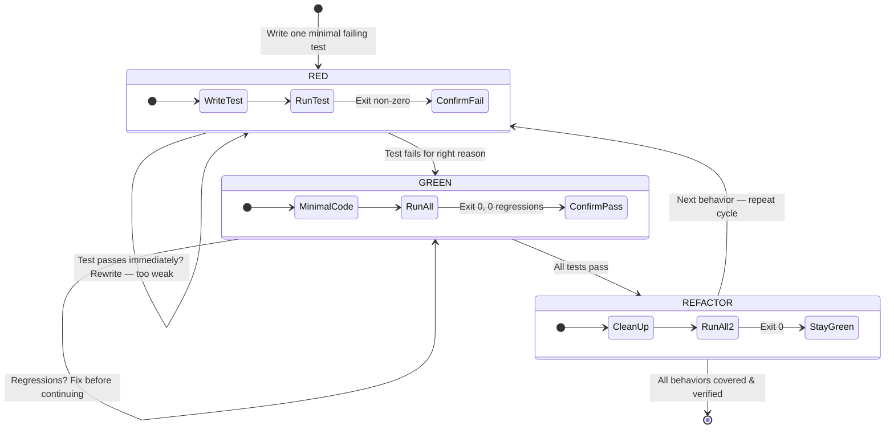

# TDD and Systematic Debugging

> Part of `super-ultra-code-plan`. The orchestrating agent reads `sucp-rules` too; a subagent follows the Rules card of its role instead. Next phase: `sucp-verify-deliver`.

## 4️⃣ 🧪 Test-Driven Development (Iron Law)
> 🧪 **Component 3: Test loop:** RED → GREEN → REFACTOR, repeated for each behavior, executed inside subagents (see Delegation & Execution for chunking, proportional fan-out, and the gather & synthesize loop).

```
NO PRODUCTION CODE WITHOUT A FAILING TEST FIRST
```
Code before test → delete, restart. No "reference", no "adapt", no exceptions.
Cycle: RED (one minimal failing test) → verify fails for right reason → GREEN (minimal code to pass) → verify passes, no regressions → REFACTOR (clean up, stay green) → repeat.
| Quality | Good | Bad |
|---|---|---|
| Minimal | One behavior per test | "and" in test name |
| Clear | Name describes behavior | test('test1') |
| Shows intent | Demonstrates desired API | Obscures intended behavior |
Exceptions require explicit human approval, asked through the Confirmation Protocol (header `TDD waiver`): throwaway prototypes, generated code, documentation/configuration-only work, and visual-only changes. Every exception still needs an appropriate verification method.
Red flags — stop, restart: code before test, test passes immediately, can't explain failure, "just this once", "keep as reference", sunk-cost argument, "spirit not ritual" argument.

- **Seams first.** Before the first RED test, list the seams under test, each with one line on what it catches and what it misses. The seams come from the approved Design or Spec, so this adds no gate; a seam found mid-task is recorded in the plan before its test is written.
- **Public interfaces.** Tests drive behavior through public interfaces, so a refactor that keeps behavior keeps them green.
- **Mock only at system boundaries:** external APIs, time, randomness, and sometimes the database or filesystem. Never mock your own modules. Inject boundary dependencies and give each external operation its own function, so each mock returns one shape without branching. This is a different rule from the Strict No-Mocking Invariant in `sucp-rules`, which is about the agent's own tool use (mock interfaces, fake tool outputs, or simulated MCP standing in for a real tool), not about test doubles at a boundary inside a test suite.
- **Domain terms.** When the target repository has a `GLOSSARY.md`, test names use its terms.

| Anti-pattern | Tell | Instead |
|---|---|---|
| Implementation-coupled | Mocks internal collaborators, tests private methods, or checks a side channel such as a direct database query; breaks on a refactor that keeps behavior | Assert through the public interface |
| Tautological | Expected value is computed the way the code computes it, so the test cannot disagree | Take the expected value from an independent source of truth: a known-good literal, a worked example, or the spec |
| Horizontal slicing | All tests first, then all code; the tests pin an imagined shape | Vertical slices: one RED, GREEN, REFACTOR cycle per behavior |



## 4.1 🐞 Systematic Debugging (Iron Law of Bug Isolation)
> 🐞 **Diagnostic loop:** FEEDBACK LOOP → REPRODUCE → DIAGNOSE (RCA) → SMALLEST SAFE FIX → REGRESSION PROOF & CLEANUP.

```
NO BUG FIX WITHOUT A MINIMAL REPRODUCING FAILING TEST AND ROOT CAUSE ISOLATION
```
Shotgun debugging, speculative edits, and fixing symptoms without root cause isolation are strictly prohibited.
Redact every secret in commands, output, and captured artifacts you show: write `<REDACTED>` in its place and keep credentials in environment variables.

**Phase 0: Build the Feedback Loop.** This is where most of the debugging effort goes.
```
NO HYPOTHESIS WITHOUT A RED-CAPABLE FEEDBACK LOOP
```
- **Done when** you can name one command, already run once with its output shown, that is red-capable (it drives the real code path and asserts the user's exact symptom, so it goes red on this bug and green once fixed), deterministic, fast (seconds, not minutes), and agent-runnable without a human.
- **Construction ladder**, try in this order:
  1. A failing test at a seam that reaches the bug.
  2. An HTTP script against a running dev server.
  3. A CLI call on a fixture, with stdout diffed against a known-good snapshot.
  4. A headless browser script asserting on DOM, console, or network.
  5. A replayed captured trace (request, payload, or event log) run through the code path in isolation.
  6. A throwaway harness that reaches the bug path through a minimal slice of the system.
  7. A property or fuzz loop, for output that is only sometimes wrong.
  8. A bisection harness between two known states, driven by `git bisect run`.
  9. A differential loop: one input through two versions or two configs, outputs diffed.
  10. A human-in-the-loop script, last resort, that still captures the output for the agent.
- **Tighten the loop:** make it faster (cached setup, narrower scope), sharpen the signal (assert the exact symptom, not "did not crash"), and make it more deterministic (pinned time, seeded randomness, isolated filesystem and network).
- **Non-deterministic bugs:** a clean repro is not the goal; raise the reproduction rate (loop the trigger, parallelise, add stress, narrow timing windows) until failures are frequent enough to debug.
- **No loop possible:** stop, list what was tried, and ask through the Confirmation Protocol (header `Blocked`) for access to an environment that reproduces it, a redacted captured artifact, or permission for temporary instrumentation. Form no hypothesis meanwhile.

1. Phase 1 — Reproduce Deterministically:
   - Write a minimal failing test or deterministic reproducer command before touching production code.
   - Confirm failure matches the reported bug symptoms exactly.
   - Minimise: cut inputs, callers, config, and steps one at a time, rerunning the loop after each cut, until every remaining element is load-bearing (removing any one turns the loop green).
2. Phase 2 — Diagnose & Isolate Root Cause:
   - Before testing any idea, write 3 to 5 ranked, falsifiable hypotheses, each with its prediction ("if X is the cause, changing Y makes the bug vanish"). A hypothesis without a prediction is sharpened or dropped.
   - Show the ranked list in chat and keep working; the user may re-rank it, but it is not a question-tool gate.
   - Probe one variable at a time, each probe tied to one prediction: debugger first, then targeted logs at the boundaries that separate hypotheses. Tag every debug log with a unique `[DEBUG-xxxx]` prefix.
   - For a performance regression, measure a baseline before bisecting (timing harness, profiler, query plan).
   - Hypothesis subagents (`bold`) are dispatched only after Phase 0 has a red-capable command, and each one receives that command.
   - Trace call stack, state transitions, and variable boundaries to identify the exact flaw.
   - Articulate the root cause clearly: what invariant was violated and why.
3. Phase 3 — Smallest Safe Localized Fix:
   - Apply the most focused, surgical patch that eliminates the root cause.
   - Strictly avoid unsolicited refactoring, cleanup of adjacent code, or changing unrelated interfaces.
   - Write the regression test before the fix, at a correct seam: one that exercises the bug pattern as it occurs at the real call site. A seam too shallow to show the bug gives false confidence, and no correct seam is itself a finding, recorded for the debt sweep. Fixing without a regression test is a TDD exception, asked through the `TDD waiver` gate; the Phase 0 loop then stands as the proof of the fix.
   - A red forced by mutating code or a fixture counts only after a diff against a pristine copy proves the mutation landed.
   - **Spiral stop.** Three fix attempts in a row that leave the Phase 0 command failing the same way end the fix loop. Count your own attempts and the attempts the user made and reported before the session. A fourth patch to the same spot is shotgun debugging. Write down the belief the three attempts had in common; it is usually that the loop runs the code being edited, when it actually loads another module, a build output, a cache, a config, or a pinned version. Check that belief with a probe that changes no product code, such as printing which file the loop resolves. A probe that breaks the belief sends you back to Phase 1 to correct the reproducer before the next fix. A belief no probe can reach, because the failure only happens where the agent cannot run anything, is the No loop possible case of Phase 0.
4. Phase 4 — Regression Proof & Verification:
   - Run the reproduction test to prove GREEN status.
   - Execute the targeted test suite to confirm 0 regressions across existing functionality.
   - Re-run the Phase 0 loop on the original, unminimised scenario.
   - Clean up: grep the files the diff touches for the session's own tag (`[DEBUG-a4f2]`, never the bare prefix, which also matches this skill and the log template) and reach zero hits, then move a throwaway harness under `docs/code-plan/spikes/<spike-id>/` or delete it.
   - The confirmed hypothesis goes into the commit message or the PR body, so the reason for the fix outlives the session.

