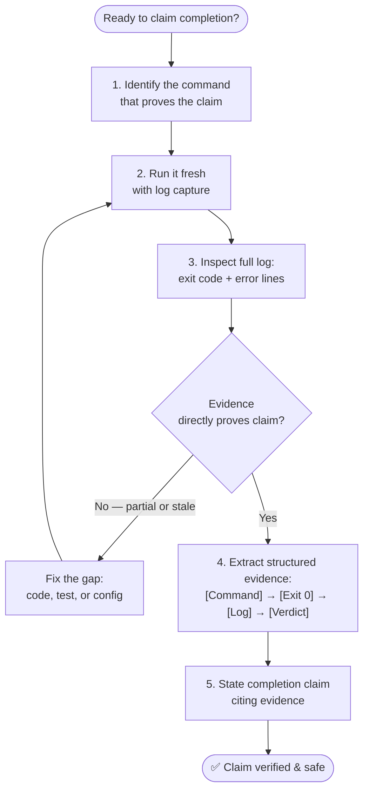
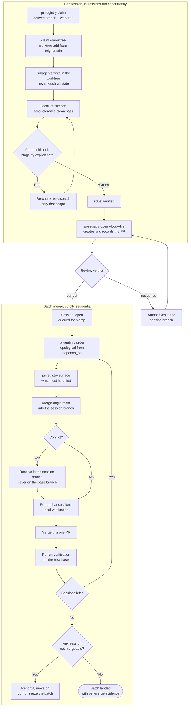

# Verification and Delivery

> Part of `super-ultra-code-plan`. The orchestrating agent reads `sucp-rules` too; a subagent follows the Rules card of its role instead. Next phase after the evidence gate: `sucp-debt-sweep`.

## 📚 Load on demand

The core rules in this file are always loaded; a reference file is read in full whenever its trigger below applies.

| Reference | Read it |
|---|---|
| [01-engineering-gates.md](references/01-engineering-gates.md) | Before a review, a completion audit, or any gate in the table above: traceability, the review rubric, CI layers, reproducibility, test reliability, rollout, privacy, and user-visible completeness. |
| [02-pr-delivery.md](references/02-pr-delivery.md) | Before claiming a session, opening a PR, moving the registry state machine, or reviewing a PR. |
| [03-verification-matrix.md](references/03-verification-matrix.md) | Before the completion audit: the minimum evidence for each change surface. |

## 🏗️ Professional Engineering Gates
Apply the gates relevant to the approved scope. Record `N/A` with a reason when a gate does not apply; never claim a gate passed without its evidence.

| Gate | Apply when | Required evidence |
|---|---|---|
| 🔗 Requirements traceability | Every requested change | Each acceptance criterion maps to a task, test/check, and final evidence |
| 🧬 Active project profile | Every plan or code change | Active root, target scope, verified configuration sources, commands, toolchain, and protected boundaries |
| 👀 Review and diff | Every non-trivial, shared, risky, or externally visible change | Diff review confirms intended files, behavior, tests, and no accidental changes or secrets |
| 🚦 CI and quality | Any code, test, configuration, or build change | Repository-required checks pass, with targeted checks run first where practical |
| 🔐 Security | Auth, permissions, secrets, input boundaries, dependencies, network, or sensitive data are involved | Allowed/denied paths, boundary checks, secret review, and relevant dependency/security audit |
| 🔄 Compatibility | API, IPC, schema, database, event, file format, or shared interface changes | Consumer impact, backward-compatibility decision, migration order, and rollback/data-preservation evidence |
| 📈 Production readiness | Deployment, runtime behavior, migration, or operational change is in scope | Observability signal, rollout plan, rollback path, and post-deployment verification |
| 📚 Documentation | Behavior, setup, configuration, API, migration, or operations change | Relevant documentation, examples, changelog, and runbook updates are accurate |
| ✅ Definition of Done | Every requested change | All applicable acceptance, quality, review, security, documentation, and operational gates are complete |
| 🧰 Reproducibility | Code, build, test, or environment behavior changes | Runtime/tool versions, setup, commands, fixtures, and environment assumptions are recorded |
| 🧪 Test reliability | Automated tests are added or changed | Tests are isolated and deterministic; flaky or environment-dependent behavior is identified and reported |
| 🔁 Plan lifecycle | A plan has multiple tasks or approval checkpoints | Status, version, decisions, superseded sections, and approval state are current |
| 📦 Supply chain | Dependencies, lockfiles, packages, or release artifacts change | Pinning/lockfile review, license check, vulnerability audit, and artifact provenance are addressed |
| 🛡️ Privacy and data governance | Personal, confidential, regulated, or user-generated data is involved | Data classification, minimization, redaction, retention, access, and audit behavior are reviewed |
| 🌐 User-visible completeness | A user-facing behavior or interface changes | Happy, loading, empty, error, retry/recovery, keyboard, accessibility, responsive, and localization states are covered as applicable |

Gate detail (traceability, security, reproducibility, test reliability, rollout, privacy, user-visible completeness): [references/01-engineering-gates.md](references/01-engineering-gates.md).

### 👀 Review, Diff & Publication
- Review the final diff, changed-file list, status, and generated artifacts before completion. Confirm that only approved files and behavior changed.
- A session ends in a pull request on its own branch, never in a commit on the working branch. See `5.5️⃣ 📤 Pull Request Delivery, Review & Batch Merge` for the isolation contract, the state machine, the body rules, and the ordered batch merge. Two related contracts live there and are not restated here: Git writes are parent-only (a subagent never commits, stages, or pushes), and a session's branch and worktree names are derived by `bun scripts/pr-registry.mjs claim` rather than chosen.
- Reviewing somebody else's pull request follows `templates/pr-review-template.md`. Reviewing your own local diff follows this section and `templates/code-review-template.md`; the difference is only what has to be fetched first and what gets posted.
- Post-Execution Final Code Review & Temp-File Purge: After plan execution completes and before any completion claim, run a dedicated final code review that (1) verifies each executed task against its acceptance criteria and cited evidence, (2) deletes every script, log, fixture, scratch file, or temporary/helper artifact created during execution, except a spike prototype kept under docs/code-plan/spikes/<spike-id>/, unless it is an explicit deliverable or part of the approved change, and (3) re-scans the worktree and final diff to confirm the deleted files are absent and only approved files remain.
- Autonomous Code Review Rubric & 8-Point Bug Qualification Filter: reviewer agents emit this contract via `templates/code-review-template.md`.

The 8-point filter and the rest of the rubric: [references/01-engineering-gates.md](references/01-engineering-gates.md).

  - Repository Rule Attribution Invariant: Every rule-supported finding MUST cite the exact supporting line range of `AGENTS.md`, `AGENTS.override.md`, or repository conventions. Subjective reviewer nitpicks or uncodified model preferences are strictly banned.
- Non-trivial or shared-interface changes should receive independent review when a reviewer is available. If no independent reviewer exists, perform and report a documented self-review; do not imply peer approval.
- Local commits follow repository conventions and the approved workflow. Pushes, releases, deployments, PR comments, and other externally visible publication require explicit authorization, asked through the Confirmation Protocol (header `Publish`, safe option first) unless the approved scope already names it.
- Never include secrets, credentials, private data, temporary artifacts, or unrelated cleanup in a commit or publication.

### 🚦 CI, Test Layers & Quality Gates
- For the commit and PR gate, the targeted gate is the default: `bun run ci:targeted` in vivera, the repository's own targeted command elsewhere (`check:terarah` in bcb), with its `--rencana` plan quoted in the PR. Run the full CI only when the targeted gate selects it, a release or installer change requires it, or the owner asks; never by habit (`sucp-rules`, Targeted Gate by Default).
## 5️⃣ ✅ Verification Before Completion (Iron Law)
> ✅ **Component 4 — Evidence gate:** identify, run, read, and confirm the proof before making the claim.

```
NO COMPLETION CLAIMS WITHOUT FRESH VERIFICATION EVIDENCE
```
Gate before any completion/success claim:
1. Identify command that proves claim
2. Run full command, fresh (with log capture or verification trail)
3. Trace and inspect full log output, exit code, failure count, and error lines
4. Extract structured log evidence: `[Command] → [Exit Code] → [Extracted Log Trace / Metrics] → [Deterministic Verdict]`
5. Confirm output directly proves the claim
6. Only then state claim, citing the verified log evidence
- Execution Over Synthesis: numeric/rendered results come from executed code, not mental math on copied text. Re-run the proving command for the claim at hand; do not reuse a stale log from an earlier step as proof for a new claim.
- Independent Check for High-Stakes Work: for production, security, migration, or irreversible changes, the final check is done by a reviewer that did not produce the work (separate subagent or documented self-review with fresh reads). The work never grades itself silently.
| Claim | Requires | Not sufficient |
|---|---|---|
| Tests pass | Fresh test output, 0 failures | Previous run, "should pass" |
| Linter clean | Fresh linter output, 0 errors | Partial check |
| Build succeeds | Build command exit 0 | Linter passing |
| Bug fixed | Original symptom retested, passes | Code changed, assumed fixed |
| Requirements met | Line-by-line checklist vs spec | Tests passing alone |
| Agent completed | VCS diff shows actual changes | Agent self-report |

Requirement-by-Requirement Completion Audit: treat every completion claim as unproven until audited.
1. Derive the concrete requirements from the objective, the approved plan, the spec, the issue, and the user's stated constraints.
2. For each requirement, name the artifact, command output, log, diff, or current file state that would prove it.
3. Classify each piece of evidence as proof, contradiction, partial, too weak, or missing.
4. Partial or too-weak evidence means NOT achieved: keep working, or report the gap precisely. Never present the result as complete with a caveat attached.
5. Intent, a plan, a prior conversation, memory of an earlier run, a green test manifest, or a reviewer summary count as proof only after confirming they actually cover the requirement in question. Match the evidence scope to the claim scope: a narrow check never proves a broad claim.

Verification matrix — run only the rows relevant to the approved scope and record `N/A` with a reason for the rest:

The matrix rows: [references/03-verification-matrix.md](references/03-verification-matrix.md).



Red flags: "should", "probably", "seems to", satisfaction expressed pre-verification, trusting agent reports without diff check, "I'm tired", "just this once".

## 5.5️⃣ 📤 Pull Request Delivery, Review & Batch Merge
> 📤 **Component 5 — Delivery:** a session ends in a pull request on its own branch, never in a commit on the working branch. This is the stage that makes twenty concurrent sessions survivable: isolation, review, and an ordered merge are the only things standing between twenty agents and twenty silently clobbering each other.

Why a PR, 5.1 isolation, 5.2 the session state machine, 5.3 opening the PR, 5.4 reviewing a PR: [references/02-pr-delivery.md](references/02-pr-delivery.md).

### 5.4 Reviewing a PR
**Generating a review and posting it are two acts.** The posted comment is a shorter artifact than the internal report: verdict, blocking findings, and nothing else. Internal reasoning and praise stay in the report. Posting is externally visible publication: the exact text is shown in chat first, then asked through the Confirmation Protocol (header `Publish`, safe option first). A reviewer that posts its own draft has skipped the only gate that exists on this stage.

### 5.5 Merging a batch of twenty PRs
```bash
bun scripts/pr-registry.mjs order        # the merge order, computed from depends_on
bun scripts/pr-registry.mjs surface <s>  # what must land in the branch first, and what blocks it
```

- **Order is topological, from the recorded `depends_on` graph, never chronological.** Ties break on session name, never a timestamp, so one registry always yields one order.
- **Already-merged sessions drop out and stop blocking their dependents.** That is the plan's own blast-radius rule applied to merges: a session waiting on nothing should still be able to land.
- **A dependency cycle is refused with the cycle named.** There is no valid order for a cycle; the remedy is to split a session, not to pick an arbitrary one.
- **Bring the base into the branch before each merge, not once at the start.** The base branch moves with every merge, so a branch updated at position 3 is already behind by position 7. `surface <s>` reports which sessions landed since the branch was cut. A session in this batch already has a PR, so the update is `git merge origin/<base>` in the session branch and a plain push, never a rebase (that needs the force push forbidden below).
- **Verify locally after every single merge.** Twenty merges followed by one test run at the end means nineteen merges ship unverified. The check after merge N is the evidence for merge N, and it is cheap because the session was already verified once.
- **One merge at a time.** A batch merge is an unverified batch.
- **Record each merge right after it:** `bun scripts/pr-registry.mjs reconcile` (or `state <s> merged`).
- **The `Close plan` gate is asked before the session's final merge, not after.** A status change after the merge needs its own PR, and that PR's plan needs another, so `status: Complete` and the readiness output ship in the session's final PR (`sucp-debt-sweep`, 6.5.5).
- **The merge itself is a question, once per merge.** Ask it through the Confirmation Protocol (header `Merge`): the first option is `Do not merge`, the second is `Merge the PR` with a description naming the PR number and the head commit. The standing gate on merging into the base branch is unchanged; the question only removes the typing.
- **A conflict is resolved in the session's branch, never on the base branch.** Merge `origin/<base>` into the session branch, resolve there, re-run that session's verification, push, then merge. Editing the base branch directly to "fix" a conflict is how a conflict becomes an unreviewable change nobody can attribute to a session.
- **If a session cannot be made mergeable, it does not merge.** Mark it and move to the next one in the order. A blocked session is a status, not a reason to freeze nineteen others.

### What is never allowed on this stage
- Committing or pushing directly to the base branch. There is no exception for a one-line fix; the exception is a separate session with its own branch.
- A hand-written branch or worktree name. Derived or nothing.
- `--force` or `--force-with-lease` on a session branch. A force push on a branch that already has a PR rewrites review history. Rebase only a branch with no PR yet; a branch with a PR takes the base by merge.
- Force-merging a conflicted PR to clear a queue. A conflict is information.
- A review verdict written into a plan mirror or a vault note. It belongs in the PR and in the source plan, both of which survive the next publish.
- Merging on the strength of a green remote CI run, or on a subagent's self-report of success.


