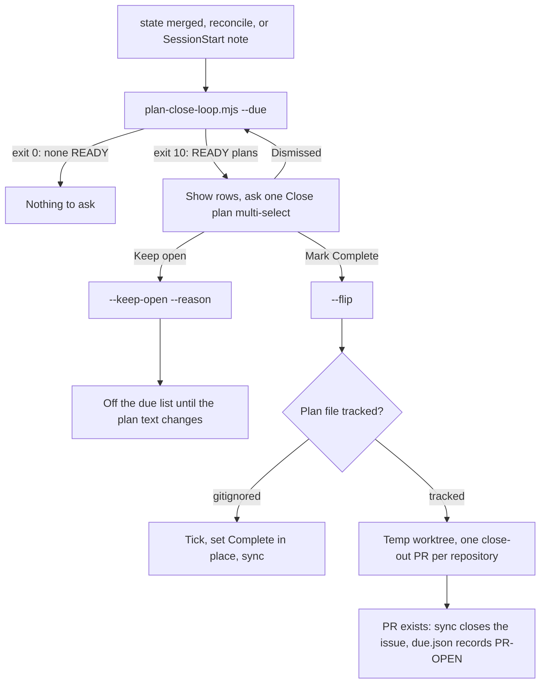

# Close-out Loop

> Loaded from `vivera-sweep` 6.5.5 when `--due`, a merge, or the session-start note lists landed plans to close. Plan: `2026-11-26-plan-close-loop`.

**Why.** Read 2026-11-26: 37 of 52 landed plans that never reached `Complete` carried a `## Closeout status` of "kept open". `Close plan` is asked once, before the session's final merge, often before the release or deploy has run, and nothing asked it again. The loop below asks it again once the plan measures done, without ever flipping a plan on its own.

**When plans come back.**

- `bun scripts/pr-registry.mjs state <s> merged` and `bun scripts/pr-registry.mjs reconcile` print the same close-out verdict for each merged session. When the plan has gaps, the lines end with `readiness: bun scripts/plan-closeout.mjs --readiness <plan file>` and `due: bun scripts/plan-close-loop.mjs --due`.
- The SessionStart hook `scripts/hooks/closeout-session-start.mjs` prints one line naming the plans the last `--due` run measured `READY` (at most 8 by name), with the `--due` command. It reads the cache only and never measures. In a repository other than vivera it lists that repository's plans only. It hides a plan kept open at its current hash and a plan whose text changed since it was measured. It always exits 0.

**`--due`.** `bun scripts/plan-close-loop.mjs --due [--repo <dir>] [--registry <path>] [--timeout-s <n>]` takes every plan whose registry sessions are all finished, with at least one merged, while the plan is not `Complete`. For each it runs `plan-closeout.mjs --readiness` (each `skip_if`, default timeout 300 seconds). Open step boxes of a `DONE` task count as tickable, not as blocking, because the flip ticks them from evidence. It prints one row per plan (`<verdict>\t<plan>\t<repo>\tasserted=<n> tickable=<n>`), a `skipped` row per plan kept open or with an open close-out PR, then `due: <n> plan(s) READY`. It writes the cache `~/.local/state/vivera-closeout/due.json` (`VIVERA_CLOSEOUT_STATE` moves the directory) and never a plan file. Exit 10 when at least one plan is `READY`, 0 when none is, 2 on a usage error or an unreadable registry.

| Verdict | Meaning |
|---|---|
| `READY` | Every task `DONE` or `DONE-ASSERTED`, no open `NOW` row, no blocking box: offered in `Close plan` |
| `NOT-READY` | An `OPEN` or `UNREAD` task, an open `NOW` row, or an open box of a task that is not `DONE` |
| `NEEDS-HUMAN` | Nothing open, but a task has no machine proof (`UNPROVEN`), or the plan has no tasks |
| `NO-FILE` | The plan file was not found where the registry points |
| `PR-OPEN` | A close-out PR for the plan is open and younger than 7 days; skipped, so no second PR is opened |
| `PR-STALE` | That PR has been open 7 days or more; listed so the owner merges or closes it |
| `UNREADABLE` | The frontmatter or the readiness run failed |

**The `Close plan` question.** Show the `--due` rows first, then ask one multi-select `Close plan` question listing the `READY` plans (at most 4 options per question, 4 questions per call; more plans go in the next call). Plans selected are `Mark Complete`: run `bun scripts/plan-close-loop.mjs --flip <plan>... [--timeout-s <n>]`. Plans not selected count as `Keep open`: run `bun scripts/plan-close-loop.mjs --keep-open <plan>... --reason <text>` with the reason the owner gave. A kept plan stays off the due list until its text changes. A dismissed question records nothing, so the plans come back on the next `--due`. Both commands take registry plan ids, and an unknown id or a missing plan file stops the run with exit 2 before anything is written.

**What `--flip` does.** Plans are grouped by the repository that holds the plan file.

- **Gitignored plans** are measured, ticked and set to `status: Complete` in place, then synced with `plan-sync.mjs`.
- **Tracked plans** go out as one close-out pull request per repository and run. The flip fetches `origin/<base>` and adds a temporary worktree `~/.cache/tmp/vivera-closeout-<stamp>-<repo>` on a new branch `closeout/<stamp>` (`<stamp>` is the local `YYYY-MM-DD-HHMMSS`). Only landed plans are accepted, by the rule `--due` uses: every registry session merged or closed and at least one merged; any other plan stops the run with exit 2. A plan whose `due.json` entry records a close-out PR (`pending_pr`) has that PR read with `gh pr view`: open or merged skips it (merged: pull, then run `--due` again), closed clears the record and flips it, and an unreadable state skips it with the `gh` error; the other plans still flip. Each plan is measured again the way `--due` measures it (`--readiness --registry`), in the main checkout, where node_modules and gitignored state exist. A plan whose main-checkout text differs from `origin/<base>` is skipped (pull, then run `--due` again), and so is a plan no longer `READY`, each with its reason. The rest get their `DONE` tasks ticked from the evidence log and `status: Complete` in the worktree copy, one commit (`docs(plans): close out <n> finished plan(s)`), a push, and one PR.
- **The issue closes only after the PR exists.** `plan-sync.mjs` then runs per plan with a temporary `PLAN_PUBLISH_CONFIG` (rule B4), `due.json` records the PR as `PR-OPEN`, and the worktree and the local branch are removed; the remote branch backs the PR.
- **A failure rolls back fully.** A failed commit, push or PR leaves the issue untouched, removes the worktree and the local branch, and deletes a branch already pushed, so a rerun starts clean. Each flip opens its own PR on its own branch. Exit 0, or 1 when any repository reports an error.
- The close-out PR is not a registry session, and merging it is still the `Merge` question (`vivera-ship`).

**DONE-ASSERTED and the evidence pair.** A task with no check command (an empty `skip_if` or the `false` sentinel) whose step boxes are all ticked counts as `DONE-ASSERTED`: done, labelled asserted, shown as `readiness: READY (<n> asserted)`. With no step box it stays `UNPROVEN`; with an open box it blocks. Tick the boxes of tasks whose `skip_if` passes from evidence, as readiness prints it:

```bash
bun scripts/plan-closeout.mjs --readiness <plan.md> --evidence readiness.log; bun scripts/plan-mark-done.mjs <plan.md> --from readiness.log
```

Joined with `;`, never `&&`: readiness exits 1 or 3 while boxes are open, and the ticks still apply. The log holds one `SKIPPED-IDEMPOTENT` line per `DONE` task, never `run[]` output; an asserted task never enters it, so a plan of asserted tasks only has nothing to tick. A runner log (`ultra-plan-runner.mjs <plan.md> --execute > runner.log`, then `--from runner.log`) remains valid when one exists.

**Unattended runs** (`vivera-overnight`) never flip and never record `--keep-open`: both are the owner's answer. They park the `Close plan` decision with the verdict under `Waiting on a human` in the handoff.

**Hook install.** The owner runs `bun ~/vivera/scripts/closeout-hooks-install.mjs --add` from the main checkout `~/vivera`, not a worktree, because the entry points at that checkout's hook file. It edits `~/.claude/settings.json` (`--settings <path>` for another file), replaces its own entry instead of adding a second one, and keeps the previous file as `.bak`. `--check` exits 0 when the entry and the hook file exist, and `--remove` takes out only this entry.



## Audit across sessions

Run `bun scripts/plan-closeout.mjs --audit` during the sweep for the repository. It reports every plan whose registry sessions are all finished with at least one merged while the plan is not `Complete`. Each plan it lists gets the same `Close plan` question in step 6.5.5.
