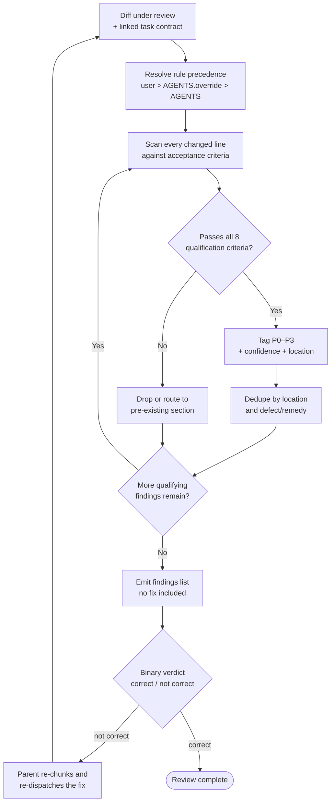

# Code Review Report: [Change / Diff Under Review]

> Structured output contract for a reviewer agent. The reviewer reports findings; it does not ship the fix.
> Populate every section. Write `none` where a section has no qualifying finding.
>
> **Scope: a local diff, a branch, or a worktree.** Reviewing a pull request
> somebody else opened is a different unit of review: remote state has to be
> fetched first, coverage has to be answered per category, and the output is a
> comment a human approves, through the Confirmation Protocol, before it is posted. Use
> `templates/pr-review-template.md` for that, and keep the 8-point qualification
> filter below as the shared core. Do not duplicate one template into the other;
> the split is what keeps the internal report and the posted comment from
> collapsing into the same artifact.

## 1. Review Scope & Inputs

- **Change under review:** [branch, commit range, or worktree path]
- **Base reference:** [commit or ref the diff is computed against]
- **Linked task contract:** [`templates/subagent-contract-template.md` chunk id, plan task id, or issue]
- **Stated intent:** [what the change is supposed to accomplish, in one or two sentences]
- **Out of scope:** [surfaces the reviewer must not comment on]
- **Reviewer type:** independent subagent | parent self-review (no independent reviewer available)
- **Axis:** Standards | Spec. The two reviewers run in parallel and neither sees the other's report. The Spec reviewer fills only Spec Axis and the verdict.
- **Spec source:** [approved spec, plan acceptance criteria, or Bounded design checklist; or `no spec available`]
- **Assumed load:** [one person running a script | many users or processes; read from the README or deploy config, and say which]

## 2. Rule Attribution Precedence

Resolve repository guidance in this order, walking from the repository root down to each changed file:

1. explicit user instruction about review scope or style
2. `AGENTS.override.md` (deepest applicable directory first)
3. `AGENTS.md` (deepest applicable directory first)
4. configured fallback instruction filename
5. repository conventions visible in the surrounding code

The most specific applicable source wins. A finding is rule-supported only when the located guidance materially contributes a repository-specific scope, invariant, remedy, or confirmation behavior beyond generic correctness advice. Ordinary findings stand on their own without rule support.

- **Guidance sources consulted:** [`path:line-range`, ...]

## 3. Bug Qualification Filter (all 8 must hold)

An issue is a genuine review finding ONLY when every criterion is satisfied:

1. It meaningfully affects correctness, performance, security, or maintainability.
2. It is discrete and actionable, not an amorphous critique of the codebase.
3. It does not demand a level of rigor or ceremony absent from the surrounding code.
4. It was introduced by this change; pre-existing debt is reported separately, not as a finding.
5. The author would likely fix it once aware of it.
6. It does not rest on unstated assumptions about intent or unstated infrastructure.
7. Affected code is provably impacted, not speculatively affected.
8. It is clearly not a deliberate design choice by the author.

**Scale lens.** It applies when the diff reads or writes shared state, loops over a collection, or serves more than one caller at a time. Against the Assumed load, look for four shapes: a check-then-write race, a list or cache that grows without a bound, a query per item, and per-process state that must be shared between processes. A scale finding needs a concrete scenario like any other, the input or situation that leads to the wrong result (criteria 1 and 7). The lens adds no ninth criterion and no new priority; calibrate with the Priority Calibration table in section 4.

Trivial style, formatting, typos, and documentation nits are not findings. If nothing qualifies, report none.

**One exception, because it is measurable rather than a matter of taste.** A comment this change *introduced* that adds nothing the code does not already show does qualify, under criteria 1 and 5: an unreadable comment is a maintainability cost every later reader pays. That covers a restated line, `// Step 1: validate`, `// Core logic`, a decorative emoji, and `} // end if`. Two limits keep it honest. It must be anchored to a line this diff actually touched, and a plain rule marking a top-level block in a long file is an index rather than slop, so it is never a finding. See **Code Comment Hygiene** in the master skill for the full rule.

A tautological test qualifies too: its expected value is recomputed the way the code computes it, so it passes whether the code is right or wrong and the behaviour it names stays untested. It is a bug finding under criteria 1 and 5, not a design note.

## 4. Findings

Report **every** qualifying finding, not the first one. Deduplicate by changed location and by defect/remedy pair before writing. Keep the reported line range as tight as possible, ideally 5–10 lines.

| Field | Requirement |
|---|---|
| Title | `[P<level>] <imperative summary>`, 80 characters or fewer |
| Priority | `P0` block everything · `P1` fix next cycle · `P2` fix eventually · `P3` nice to have |
| Location | Absolute file path plus tight start and end line |
| Body | One paragraph: the defect, the concrete scenario that triggers it, and the impact. State explicitly which inputs, environment, or state the finding depends on |
| Confidence | `0.0`–`1.0` numeric |
| Rule support | Exact `path:line-range` of the governing rule, or omit when the finding is self-evident |

### Priority Calibration

| Level | Use when |
|---|---|
| `P0` | Universal failure independent of inputs, or the patch must be dropped entirely |
| `P1` | Urgent: breaks a documented contract, loses data, or opens a security hole on a realistic path |
| `P2` | Normal defect, correct on the intended path, breaks on an edge case worth fixing |
| `P3` | Low value polish; the author may decline it |

### Finding Example

```
[P2] Clear the staged lockfile before resolving the new transitive dep

`bun install` runs before `git add bun.lock`, so the commit can capture
a lockfile rewritten by a later unrelated install in the same run. Anyone checking
out that commit and running `bun install --frozen-lockfile` gets a resolution error
instead of the pinned tree. Move the staging line after the install and add
`git diff --exit-code bun.lock` to the verification step.
```

### Suggestion Blocks

Use a suggestion block only for a concrete, minimal replacement. Preserve the exact leading whitespace of the replaced lines and never change surrounding indentation. No commentary inside the block.

````
```suggestion
-  const timeout = 5000
+  const timeout = process.env.REQUEST_TIMEOUT_MS ?? 5000
```
````

### Spec Axis

The Spec reviewer compares the diff with the spec source and uses the same finding fields. The spec line it quotes in the Body takes the place of rule support.

| Kind | Priority |
|---|---|
| Requirement missing or only partly built | `P1` |
| Requirement built wrongly | `P0` or `P1` |
| Scope creep: behaviour the spec did not ask for | `P2`, or `P1` when it touches a Protected Boundary or a Non-Goal |

With no spec source, write "no spec available" here. Standards findings and Spec findings are shown side by side, each in its own order, and never reranked against each other.

## 5. Design Notes (non-blocking)

The Standards reviewer reads the diff against the fixed baseline below. Write each note as "possible <smell>" with the hunk it points at. A note has no priority, never changes the verdict, and is never posted to the PR. A documented repository standard overrides a smell, and anything a linter, formatter, or type checker enforces is skipped. The baseline is codified here and cannot block, so a note is not a finding. The Step 6 debt sweep harvests the notes. Write `none` when nothing applies.

| Smell | Possible when the diff shows | Usual remedy |
|---|---|---|
| Mysterious Name | a name that does not say what the thing does or holds | rename it; if no honest name fits, the design is unclear |
| Duplicated Code | the same logic in two hunks or files | extract it once and call it from both |
| Feature Envy | a function that uses another module's data more than its own | move it next to that data |
| Data Clumps | the same few values always passed together | group them into one type |
| Primitive Obsession | a string or number standing in for a domain concept | give the concept its own small type |
| Repeated Switches | the same branch on the same type in several places | one shared lookup, or polymorphism |
| Shotgun Surgery | a single change spread as small edits over many files | gather what changes together into one module |
| Divergent Change | one file edited for several unrelated reasons | split it so each part changes for one reason |
| Speculative Generality | parameters, hooks, or layers no requirement asks for | remove it until a real need appears |
| Message Chains | a caller walking `a.b().c().d()` | give the first object one method that does the walk |
| Middle Man | a module that mostly forwards calls | call the real target directly |
| Refused Bequest | a subtype that ignores or overrides most of what it inherits | replace the inheritance with composition |

## 6. Pre-Existing Issues (reported, not filed as findings)

- [Issue observed in surrounding code, with `path:line` and why it is out of this change's scope]

## 7. Correctness Verdict

End every review with one explicit binary verdict, justified in one to three sentences.

- **Verdict:** `correct` | `not correct`
- **Justification:** [does the patch break existing code, tests, or contracts; are there blocking defects]
- **Overall confidence:** `0.0`–`1.0`
- **Two axes:** `not correct` when either axis holds a `P0` or `P1`. Design notes never change the verdict.

## 8. Reviewer Self-Check

- [ ] Every reported finding passes all 8 criteria in section 3.
- [ ] All qualifying findings were reported, not just the first.
- [ ] Findings were deduplicated by location and by defect/remedy pair.
- [ ] No pre-existing issue was filed as a finding.
- [ ] No speculative breakage was reported without provable impact.
- [ ] No praise, no filler apology, and no restatement of the diff back to the author.
- [ ] No fix was applied and no patch was emitted; the review reports only.
- [ ] Verdict stated, with the conditions that would change it.
- [ ] Every Spec finding quotes its spec line, and the two axes are reported side by side, never reranked.
- [ ] Every design note says possible, has no priority, and stayed out of the verdict and the PR.


