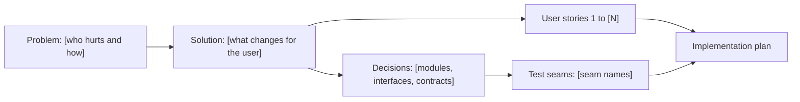

# Spec: [Feature or Change Name]

> The design doc for an Architectural path, written at brainstorm step 6 and saved to
> `docs/code-plan/specs/YYYY-MM-DD-<topic>-design.md`. It stays at the level of behaviour and decisions;
> it feeds `templates/implementation-plan-template.md`, which carries the exact paths and commands.

- **Status:** Draft | Approved (`Spec` gate, [YYYY-MM-DD])
- **Date:** [YYYY-MM-DD]
- **Path:** Architectural ([one line: why this change needs a spec])
- **Related:** [intent lock report, spike reports, ADRs, or N/A]

## Problem Statement

[What hurts and for whom, told from the user's side. Describe the observed behaviour, not the code behind it.]

## Solution

[What changes for the user once this ships, also from the user's side. The mechanics go in Implementation Decisions.]

## User Stories

Make the list long: cover every actor, the main flow, and the error and recovery paths. One story per item, in the form "As a <actor>, I want <feature>, so that <benefit>".

1. As a [actor], I want [feature], so that [benefit].
2. As a [actor], I want [feature], so that [benefit].
3. As a [actor], I want [feature], so that [benefit].

## Implementation Decisions

Record decisions with no file paths and no code, since both go stale fast. Name modules by their role, using the Glossary terms.

- **Modules:** [modules built or changed, and the responsibility of each]
- **Interfaces:** [the public surface each module adds or changes]
- **Schema:** [new or changed data shapes, storage, migrations]
- **Contracts:** [API, CLI, file format, or event contracts that other parts rely on]
- **Architecture:** [each decision with its reason; link the ADR when one exists]

Exception: when a prototype produced an excerpt that pins a decision more exactly than prose can (a state machine, a type shape, a schema), quote only the lines that carry the decision, under that decision, labelled `Prototype excerpt from <spike-id>`.

## Testing Decisions

- **What a good test is here:** [it observes behaviour at a public seam, not internal steps, and fails when that behaviour breaks]
- **Seams:** prefer an existing seam and the highest one that works; add a new seam only when none fits.

| Seam | What it catches | What it misses |
|---|---|---|
| [public boundary a test observes] | [failures it detects] | [failures it cannot see, and what covers them] |

- **Prior art:** [existing tests in this codebase to follow]

## Glossary

- **[Term]:** [one-line meaning in this project, matching `GLOSSARY.md`]

## Out of Scope

- [Item left out, with a one-line reason or the follow-up that owns it]

## Outcome Check (optional)

When filled, this becomes a post-merge follow-up outside `tasks[]` (memory rule L35), not a plan task. When the effect cannot be measured, write N/A with the reason.

- **Metric:** [the number that shows the Problem Statement went away]
- **Baseline:** [value] on [YYYY-MM-DD], from [the command that measured it]
- **Check after merge:** [when to measure again, such as 7 days after the merge]

## Further Notes

- [Anything the planner needs that fits no section above: rollout, risks, open follow-ups]

## Visual Map

## Approval

| Gate | Answer | Date |
|---|---|---|
| [question or gate header, such as `Intent`] | [the user's answer] | [YYYY-MM-DD] |
| `Spec` | [Approve, or the change requested] | [YYYY-MM-DD] |
