# Systematic Debugging Log: [Issue Description]

## 1. Issue Summary
- **Reported Bug:** [User description or error symptom]
- **Environment:** [OS, runtime, package version, commit hash]
- **Affected Subsystem:** [Module, endpoint, or component]

## 1b. Debugging Loop

```mermaid
stateDiagram-v2
    accTitle: Systematic debugging state machine
    accDescr: Phase 0 builds a red-capable feedback loop, then the bug is reproduced and minimised, ranked hypotheses are probed one at a time, the smallest safe fix lands with a regression test, and verification ends with cleanup. When no loop can be built the work waits at a Blocked gate; a falsified hypothesis or a regression loops back to DIAGNOSE.
    [*] --> FEEDBACK : Bug reported
    FEEDBACK --> FEEDBACK : Loop slow, flaky, or blind to the symptom, so tighten it
    FEEDBACK --> BLOCKED : No loop can be built
    BLOCKED --> FEEDBACK : Environment, artifact, or instrumentation granted
    FEEDBACK --> REPRODUCE : Red-capable command named and run
    REPRODUCE --> DIAGNOSE : Every remaining element is load-bearing
    DIAGNOSE --> DIAGNOSE : Prediction failed, probe the next hypothesis
    DIAGNOSE --> FIX : Hypothesis confirmed
    FIX --> VERIFY : Regression test GREEN
    VERIFY --> DIAGNOSE : Regressions found, root cause incomplete
    VERIFY --> [*] : Loop green, 0 regressions, debug tags removed

    state FEEDBACK {
        [*] --> ClimbLadder
        ClimbLadder --> RunOnce
        RunOnce --> Tighten
    }
    state REPRODUCE {
        [*] --> GoRed
        GoRed --> Minimise
    }
    state DIAGNOSE {
        [*] --> RankHypotheses
        RankHypotheses --> ProbeOneVariable
        ProbeOneVariable --> ConfirmOrFalsify
    }
    state FIX {
        [*] --> RegressionTestAtSeam
        RegressionTestAtSeam --> SmallestSafePatch
    }
    state VERIFY {
        [*] --> RerunPhase0Loop
        RerunPhase0Loop --> RunFullSuite
        RunFullSuite --> GrepDebugTags
    }
```



## 1c. Phase 0: Feedback Loop
- **Red-capable command** (already run at least once; secrets shown as `<REDACTED>`):
  ```bash
  [Command that drives the bug path and asserts the exact symptom]
  ```
- **First run output:** [Redacted output showing red]
- **Ladder rung used:** [Failing test, HTTP script, CLI fixture diff, headless browser, replayed trace, throwaway harness, property or fuzz loop, `git bisect run` harness, differential loop, or human-in-the-loop script]
- **Loop checks:**
  - [ ] Red-capable: drives the real code path and asserts the user's exact symptom
  - [ ] Deterministic, or reproduction rate recorded: [N of M runs]
  - [ ] Fast: [seconds per run]
  - [ ] Agent-runnable without a human
- **If no loop could be built:** [What was tried, and what was asked through the `Blocked` gate]

## 2. Phase 1 — Deterministic Reproduction (Failing Test First)
- **Minimal Reproducer Test / Command:**
  ```bash
  rtk bun test path/to/repro.test.ts
  ```
- **Observed Failure Output:**
  ```
  [Paste exact error message, call stack, or failure exit code]
  ```
- **Confirmation:** [ ] Confirmed fails deterministically for the exact reason reported.
- **Minimised:** [ ] Every remaining element is load-bearing (removing any one turns the loop green).

## 3. Phase 2 — Root Cause Analysis (RCA)
**Ranked Hypotheses** (3 to 5, falsifiable, shown in chat before probing):

| Rank | Hypothesis | Prediction (if this is the cause, then...) | Probe | Result |
|---|---|---|---|---|
| 1 | [Suspected cause] | [Changing Y makes the bug vanish] | [Breakpoint or tagged log] | [Confirmed / Falsified] |
| 2 | | | | |
| 3 | | | | |

- **Debug tag:** `[DEBUG-xxxx]` (carried by every debug log in this session)
- **Performance baseline** (performance regressions only): [Measurement taken before bisecting]
- **Execution Trace:** [Step-by-step trace of state leading up to error]
- **Violated Invariant:** [What invariant, boundary condition, or contract broke?]
- **Root Cause Explanation:** [Why did this occur?]

## 4. Phase 3 — Smallest Safe Localized Fix
- **Target File(s):** `path/to/source.ts`
- **Fix Description:** [Describe the minimal change applied without unrelated refactoring]
- **Patch Preview:**
  ```diff
  - // problematic line
  + // localized fix
  ```
- **Regression Test Seam:** [Seam and test path, or "no correct seam", recorded as a debt-sweep finding]
- **Forced red proof:** [Diff against a pristine copy, when the red was forced by mutating code or a fixture]

## 5. Phase 4 — Regression Verification
- **Reproduction Test Status:**
  - Command: `rtk bun test path/to/repro.test.ts`
  - Output: Exit 0, 1 passed, 0 failed.
- **Full Suite Status:**
  - Command: `rtk bun test`
  - Output: Exit 0, all existing tests passed.
- **Original scenario:** [ ] Phase 0 loop re-run on the unminimised scenario is green.
- **Debug-tag cleanup:** [ ] a grep for the session's own tag (`[DEBUG-xxxx]` as recorded above, never the bare prefix) over the files the diff touches returns 0 hits; this log is excluded.
- **Throwaway harness:** [ ] Moved under `docs/code-plan/spikes/<spike-id>/` or deleted.
- **Confirmed hypothesis:** [Rank N, one sentence, copied into the commit message or the PR body]
- **Verdict:** [ ] Bug resolved with 0 regressions.
